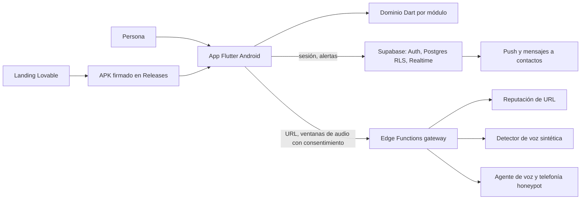

# QHAWIX

Suite de seguridad personal para Android: protege a la persona de estafas digitales y telefónicas con IA, y **oculta o restringe sus billeteras digitales** cuando el contexto indica que está en peligro físico. *Qhawix* significa "vigía" en quechua.

> **Estado:** especificación y diseño. **Implementación no iniciada**: el repositorio contiene los esqueletos de `ui/` y `api/`, la documentación y la configuración de agentes. Nada de lo descrito abajo existe todavía como código.

**Principio del producto: nada se simula.** Cada función debe actuar sobre el mundo real. Cuando Android o una billetera no permiten una acción, se propone un mecanismo alternativo que llegue al mismo fin y se documenta el límite (ver [Lo que Android no permite](#lo-que-android-no-permite-y-qué-hacemos)).

## Módulos

Como una suite de oficina, cada módulo funciona solo y se potencia con los demás.

| Módulo | Para qué sirve | Carpeta |
| --- | --- | --- |
| **Sentinel** | Analiza mensajes, correos y comprobantes en busca de engaño | `features/sentinel` |
| **Escudo QR** | Muestra y comprueba un QR o enlace antes de abrirlo | `features/qr_shield` |
| **EchoTrap** | Detecta voz clonada por IA en llamadas y atrapa al estafador | `features/echotrap` |
| **Refugio** | Detecta riesgo físico y oculta las billeteras | `features/refuge` |
| **Guardian Pago** | Pone una compuerta real antes de pagar o abrir una billetera | `features/guardian_pay` |
| **Red de Confianza** | Alerta y coordina a familiares y contactos de confianza | `features/trust_circle` |
| **Bitácora** | Línea de tiempo, evidencia e informes de incidentes | `features/logbook` |
| **AURA** | Asistente que explica, guía y educa | `features/aura` |
| **Plataforma** | Backend, cuentas, distribución, landing y alianzas | `api/`, landing |

**Etiquetas de viabilidad usadas en todo el documento:**
`[Real]` factible con APIs estándar de Android · `[Requisito]` factible con un permiso, cuenta o configuración especial · `[Spike]` posible pero sin verificar: se valida con una prueba corta antes de construir · `[Futuro]` depende de acuerdos o investigación.

### 1. Sentinel: comunicaciones

- Análisis de texto pegado, importado (`.txt`) o compartido desde otra app, con canal y procedencia declarados. `[Real]`
- Señales con cita y motivo (OTP/PIN, cuenta segura, acceso remoto, urgencia, amenaza, cambio de destinatario, suplantación de banco/policía/familiar). `[Real]`
- Redacción de datos sensibles antes de guardar. `[Real]`
- Resistencia a inyección de instrucciones en el texto analizado. `[Real]`
- Phishing por SMS, correo y enlaces (reputación de URL vía Escudo QR). `[Requisito]`
- Comprobantes: lectura de monto, fecha y destinatario y detección de inconsistencias visuales. Resultado: "comprobante analizado", nunca "pago verificado". `[Spike]`
- Modelo de lenguaje opcional como segunda opinión; nunca autoriza ni retiene por sí solo. `[Requisito]`
- Español primero; quechua y aimara después. `[Futuro]`
- Desinformación y noticias falsas. `[Futuro]`

### 2. Escudo QR

- Captura por cámara bajo demanda, por imagen elegida o por URL pegada. `[Real]`
- Clasificación: URL, texto, vCard, calendario, Wi-Fi, teléfono, SMS, correo, pago. Nada se ejecuta solo. `[Real]`
- Validación local de URL (homógrafos, acortadores, IP privada, esquemas peligrosos). `[Real]`
- Tres resultados: coincidencia conocida, sin coincidencia con cobertura completa, **no verificable**. `[Requisito]` (cuenta de Web Risk)
- Apertura en navegador externo solo tras un toque explícito y revalidando la URL. `[Real]`

### 3. EchoTrap: estafas telefónicas con IA

Basado en el estudio [`echotrap-next`](docs/echotrap-next%20%281%29.pdf): detector de voz clonada en tiempo real, más un honeypot que dilata al estafador y alerta a la familia.

- **Llamadas internas entre cuentas QHAWIX** por LiveKit: el usuario inicia o contesta desde la app; el teléfono receptor recibe el audio remoto y lo analiza durante la conversación. La sesión necesita que ambos tengan QHAWIX instalado, sesión iniciada y la app disponible. `[Real, prueba en dos teléfonos pendiente]`
- **Transcripción y riesgo en vivo**: fragmentos cortos se envían con consentimiento a Deepgram; Gemini es el respaldo de transcripción y el clasificador de señales. El audio no se guarda en QHAWIX. El resultado es una alerta de riesgo, no una identificación del hablante ni prueba de delito. `[Real, calibración pendiente]`
- **Búsqueda oficial**: cuando la conversación presenta señales de riesgo, se puede consultar Exa con el nombre de la entidad y mostrar fuentes oficiales permitidas. Una noticia sobre la institución no demuestra quién llama. `[Real, falta la clave de Exa en Supabase]`
- **Estimación de voz sintética**: una muestra de 10 segundos puede revisarse con TruthScan, solo con consentimiento; el resultado es experimental. `[Real, falta la clave de TruthScan en Supabase]`
- **Llamadas del operador, WhatsApp y otras apps**: QHAWIX no obtiene su audio ni puede silenciar su micrófono o hablar por la persona. No se debe presentar como protección de esas llamadas.
- **Honeypot telefónico y agente que contesta**: no implementados. Requieren un número telefónico y conexión con un proveedor de telefonía.

### 4. Refugio: seguridad física y billeteras

Detecta que el contexto es anómalo y **oculta o restringe las billeteras** para que un agresor que obligue a la persona a abrir su teléfono no encuentre nada que robar.

**Disparadores**
- Automático: hora (por ejemplo, de noche) y lugar fuera de lo habitual según una línea base aprendida **en el dispositivo**. `[Requisito]` (ubicación "todo el tiempo")
- Manual: gesto o botón de pánico discreto. `[Real]`
- Remoto: un contacto de confianza activa el Refugio con autenticación. `[Requisito]`
- Zonas: casa, trabajo, llegada segura, desvío de ruta, horarios. `[Requisito]`

**Acciones: el mismo fin por tres niveles según el dispositivo**

| Nivel | Qué logra | Requisito | Costo |
| --- | --- | --- | --- |
| **A. Disfraz y compuerta** | QHAWIX cambia su propio icono y nombre; una pantalla de QHAWIX cubre la billetera al intentar abrirla y exige enfriamiento o aprobación. `[Spike]` | Permisos de uso y superposición | La billetera sigue visible en el menú; algunas apps bancarias detectan superposiciones |
| **B. Perfil de trabajo** | Las billeteras viven en un perfil separado que QHAWIX oculta o suspende. `[Spike]` | Instalar las billeteras dentro del perfil | Volver a iniciar sesión; no todas las apps lo soportan |
| **C. Dispositivo administrado** | Ocultar, suspender o bloquear la desinstalación de cualquier app. `[Requisito]` | Registro como administrador del dispositivo, que exige **restablecer de fábrica** | Ideal para un teléfono nuevo o dedicado |

Complementos: Espacio Privado de Android 15 (el bloqueo programático está por verificar) y ocultar contenido sensible propio ante miradas ajenas. Desinstalar una billetera es la última opción: es destructivo y obliga a reiniciar sesión; se prefiere ocultar o suspender.

Restaurar las billeteras exige verificación de la persona (biometría o PIN) y, si se configuró, la aprobación de un contacto de confianza.

### 5. Guardian Pago

No simula transferencias: pone fricción real donde la persona decide pagar.

- Análisis de una solicitud de pago (texto o captura) con las reglas de riesgo y las cuatro dimensiones independientes: procedencia del número, confirmación de la institución, riesgo de la solicitud y desviación de conducta. `[Real]`
- Resultado permitir, advertir o retener, con motivos explicables. `[Real]`
- Si se retiene: la **compuerta de billetera** (nivel A, B o C de Refugio) impone enfriamiento y no se abre hasta completar la verificación. `[Spike]`
- **Verificación independiente** guiada: contacto desde la app oficial, reverso de tarjeta o estado de cuenta; se rechaza el contacto que aportó el solicitante. `[Real]`
- **Aprobación de un contacto de confianza** antes de un pago alto. `[Requisito]`
- Congelar cuentas: no hay integración posible con las billeteras, así que QHAWIX ofrece pasos guiados y accesos directos a las pantallas oficiales de bloqueo y a las líneas de atención, más la ocultación de Refugio. `[Real]`
- Integración directa con Yape y bancos para verificar movimientos o bloquear. `[Futuro]` (acuerdo oficial)

### 6. Red de Confianza

- Contactos de confianza sin necesidad de instalar la app ni aceptar una invitación (por ejemplo, tu mamá solo con su número). Quedan activos al agregarlos. `[Real]`
- Contactos con la app, mediante una invitación opcional a instalar QHAWIX: habilitan alertas push, ubicación temporal en vivo y pedidos de Refugio remoto. `[Requisito]`
- Alertas push, SMS o WhatsApp ante voz clonada, retención de pago o Refugio activado. `[Requisito]`
- SOS con ubicación temporal compartida solo con consentimiento. `[Requisito]`
- Llegada segura, check-ins y bienestar. `[Requisito]`
- Activación remota de Refugio. `[Requisito]`
- Círculo familiar con palabra clave compartida. `[Real]`

### 7. Bitácora

- Línea de tiempo append-only por caso, con borrado completo a pedido. `[Real]`
- Evidencia con redacción y retención explícita. `[Real]`
- Informe de incidente exportable para denunciar. `[Real]`
- Reporte de falsa alarma sin recalibración silenciosa. `[Real]`
- Correlación de campañas y reportes colectivos con controles contra abuso (TRUSTGRAPH). `[Futuro]`
- Bóveda de comprobantes con enlaces revocables. `[Futuro]`

### 8. AURA

- Guía textual y recursos curados, sin simular voz ni autoridad institucional. `[Real]`
- Chat con modelo de lenguaje y respuestas acotadas. `[Requisito]`
- Voz y triple toque de emergencia. `[Futuro]`
- Accesibilidad completa (lector de pantalla, escala de texto, objetivos táctiles de 48 dp). `[Real]`

### 9. Plataforma

- Cuentas, contactos y alertas sobre Supabase (Auth, Postgres con RLS, Realtime). `[Real]`
- Gateway de reputación y de detección de voz que custodia las claves. `[Real]`
- Landing en Lovable y APK firmado por enlace HTTPS y QR. `[Real]`
- SDK B2B para bancos y billeteras, y alianzas con operadores. `[Futuro]`
- Servidores MCP y agentes de inteligencia. `[Futuro]`
- Laboratorio de escenarios y evaluación (Sentinel Lab). `[Real]` interno, `[Futuro]` público.

## Lo que Android no permite y qué hacemos

| Lo que se querría | Por qué no se puede | Alternativa que llega al mismo fin |
| --- | --- | --- |
| Congelar una cuenta o billetera | No hay API pública de las billeteras | Ocultarla o suspenderla (Refugio) y guiar al bloqueo oficial |
| Cambiar el icono de otra app | Solo se puede cambiar el de la propia app | Disfrazar a QHAWIX; ocultar la billetera por perfil o administración |
| Desinstalar apps sin preguntar | Exige confirmación del usuario o administración del dispositivo | Ocultar o suspender (nivel B o C); desinstalar solo como último recurso |
| Escuchar el audio de la llamada | Android bloquea la fuente de audio de llamadas a apps de terceros; la vía por accesibilidad fue prohibida en Play | Llamada en altavoz con micrófono en primer plano; filtro de llamadas sin audio |
| Monitorear en segundo plano sin avisos | Android 14 exige tipo de servicio y permisos declarados | Servicio en primer plano visible solo durante la llamada |
| Ubicación continua | Geofencing en segundo plano exige "permitir todo el tiempo" y procesa eventos cada pocos minutos | Pedir el permiso con explicación; cuadrículas y zonas en lugar de seguimiento exacto |
| Interceptar WhatsApp o QR de otras apps | Flutter no concede esos privilegios | Compartir hacia QHAWIX y análisis bajo demanda |

## Arquitectura



- **Minimizar datos:** el texto, el audio y la ubicación se procesan en el dispositivo por defecto. Lo que sale va con consentimiento específico y finalidad declarada.
- **El servidor guarda lo mínimo:** cuenta, contactos de confianza y eventos de alerta. No guarda audio, ni mensajes, ni la línea base de ubicación.
- **Dominio puro y desacoplado:** cada módulo depende de interfaces de repositorio; el reloj se inyecta.

Especificación previa y evidencia: [especificación maestra](docs/QHAWIX-ESPECIFICACION-MAESTRA.md). Su alcance de MVP (sin audio, sin cuentas, con simulador) **queda superado** por esta definición.

## Estructura del repositorio

| Carpeta | Contenido |
| --- | --- |
| `ui/` | App Flutter (Android), una carpeta por módulo en `lib/features/` |
| `api/supabase/` | Proyecto Supabase: migraciones, políticas RLS y Edge Functions (TypeScript sobre Deno) |
| `contracts/` | Esquemas de la API y eventos *(por crear)* |
| `docs/` | Especificación maestra y fuentes originales (evidencia, no se editan) |
| `odd/tasks/` | Seguimiento de funcionalidades |
| `AGENTS.md` | Reglas para agentes y colaboradores |

## Primeros pasos

**Requisitos:** Flutter (estable), Node.js con `npx`, y Docker (solo para el backend local).

```bash
# App
cd ui
flutter pub get
dart analyze
flutter test

# Backend local (requiere Docker)
cd ../api
npx supabase start
npx supabase functions serve
```

Para ejecutar la app, copia `ui/env/example.json` a `ui/env/local.json`, completa los valores y usa:

```bash
cd ui
flutter run --dart-define-from-file=env/local.json
```

`ui/env/local.json` está ignorado por Git. La clave anónima de Supabase es pública por diseño; las claves de proveedores nunca van en la app ni en el repositorio.

> Verificado sobre el esqueleto: `dart analyze`, `flutter test` y la versión del CLI de Supabase. `supabase start` y `functions serve` no se probaron.

## Hoja de ruta

Orden propuesto: primero lo que reduce más riesgo con menos incertidumbre técnica.

- [ ] **Fase 0: spikes de viabilidad** (ver abajo). Deciden el diseño de Refugio y EchoTrap.
- [ ] **Fase 1:** arquitectura, cuentas y plataforma base
- [ ] **Fase 2:** Sentinel, Escudo QR y Bitácora
- [ ] **Fase 3:** EchoTrap: detector en altavoz y alerta a la Red de Confianza
- [ ] **Fase 4:** Refugio (nivel A) y Guardian Pago
- [ ] **Fase 5:** Refugio avanzado (niveles B y C) y honeypot telefónico
- [ ] **Fase 6:** AURA, landing y distribución del APK
- [ ] **Fase 7:** seguridad, privacidad y validación en dispositivos físicos

## Validaciones pendientes (spikes)

Cada una es una prueba corta en un dispositivo real, antes de construir el módulo que depende de ella.

| Spike | Pregunta que responde |
| --- | --- |
| S-01 | ¿Qué puede ocultar o suspender un perfil de trabajo, y las billeteras peruanas funcionan dentro de él? |
| S-02 | ¿Una app de administración de dispositivo oculta y suspende billeteras de forma fiable? ¿Cuánto cuesta el registro? |
| S-03 | ¿Las apps bancarias y de billeteras se niegan a correr con superposición o accesibilidad activas? |
| S-04 | ¿Se puede bloquear por código el Espacio Privado de Android 15? |
| S-05 | ¿Qué precisión tiene el detector de voz con altavoz y línea telefónica reales? |
| S-06 | ¿Funciona el reenvío condicional hacia el agente honeypot con los operadores peruanos? |
| S-07 | ¿Cambiar el icono propio en caliente es fiable en los fabricantes más comunes? |

## Decisiones abiertas

- Proveedores: reputación de URL, detección de voz, voz y telefonía. Sus precios y cuotas se reconfirman antes de elegir.
- Modelo de datos del servidor y política de privacidad por país.
- Consentimiento y legalidad de grabar o transcribir llamadas, y de clonar voces solo para pruebas (únicamente con consentimiento del titular).
- Identificador del paquete Android, firma del APK, cuenta de Lovable y formato de entrega al jurado.

## Para colaborar

Lee [`AGENTS.md`](AGENTS.md): reglas de producto, módulos, arquitectura, pruebas y límites. Commits con Conventional Commits, en una rama `feature/<nombre>`.
