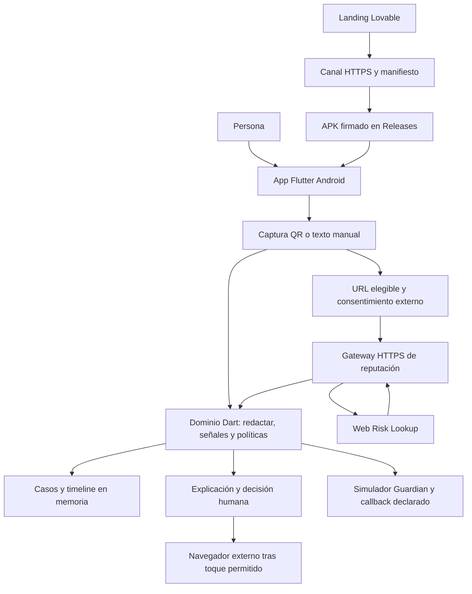
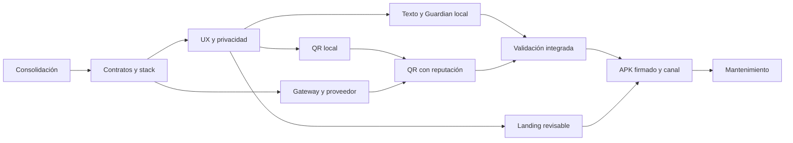

# QHAWIX — Especificación maestra y guía de implementación

**Versión documental:** 1.0.0. **Fecha de revisión:** 17 de octubre de 2026, America/Bogota.

**Estado:** planificación y especificación; las funciones nuevas descritas aquí requieren implementación y validación. **Rama de elaboración:** `feature/docs-qhawix`.

**Autoridad y lectura:** el encargo actual establece Flutter/Dart como producto principal, landing con Lovable y Escudo QR obligatorio. Esta especificación resuelve el alcance para la siguiente implementación y conserva la procedencia de las ideas. Los documentos originales permanecen como evidencia histórica. En caso de conflicto sobre plataforma o prioridad, prevalece el encargo actual; las decisiones adicionales de este documento son recomendaciones de diseño, no capacidades existentes ni resultados de pruebas.

**Etiquetas:** **U** = exigencia actual del usuario; **R** = decisión técnica recomendada aquí; **H** = idea histórica; **O** = observado en lectura estática; **A** = afirmación de una fuente sin verificación operativa; **S** = supuesto de planificación pendiente de validación. P0 es el lanzamiento inicial propuesto; P1 y P2 son ampliaciones condicionadas. Una API documentada no equivale a una cuenta habilitada.

## 1. Resumen ejecutivo

QHAWIX ayudará a reconocer señales de engaño antes de abrir un enlace, compartir datos o realizar un pago. El producto principal será una aplicación Flutter para Android. La landing Lovable explicará su funcionamiento y distribuirá un APK firmado mediante un enlace HTTPS y un QR de descarga.

El MVP reúne cuatro capacidades conectadas: **SENTINEL texto** para examinar comunicaciones aportadas voluntariamente; **Guardian** para demostrar una política de permitir, advertir o retener una transferencia ficticia ligada a la evidencia; **verificación independiente y línea de tiempo de sesión**; y **Escudo QR** para mostrar el contenido antes de actuar y consultar reputación cuando corresponda. El análisis de texto y Guardian funcionarán localmente. Un backend mínimo protegerá las credenciales de reputación.

Escudo QR integra una propuesta nueva y obligatoria; no reemplaza las demás ideas. La telefonía propia de `pino.md`, la biometría bancaria, TRUSTGRAPH, Shield, PHANTOM y las integraciones con bancos se conservan en una hoja de ruta con límites y dependencias. Los primeros entregables deberán probar una prevención comprensible; no se presupone detección infalible, control de Yape, bloqueo del sistema operativo ni autorización bancaria.

La recomendación para reputación es Google Web Risk **Lookup**, condicionada a acceso, condiciones, privacidad y control de gasto. Safe Browsing, VirusTotal pública y OpenPhish Community tienen restricciones que impiden tratarlos como sustitutos comerciales gratuitos universales. La captura propuesta es `mobile_scanner`, un plugin comunitario que utiliza ML Kit en Android. La evaluación documental de herramientas y sus fuentes está en §§13, 21, 34 y 41.

## 2. Descripción general del proyecto

La visión amplia es una capa de seguridad personal, digital y financiera que relaciona evidencias, explica señales y propone acciones proporcionadas. El alcance ejecutable inicial se centra en material que la persona introduce en QHAWIX y en decisiones dentro de la propia aplicación.

| Componente | Responsabilidad | Estado |
|---|---|---|
| Aplicación Android Flutter/Dart | Texto, enlaces, QR, explicaciones, simulador Guardian, revisión y privacidad | U para plataforma; R para composición del MVP |
| Backend de reputación | Custodiar claves, validar consultas, consultar proveedor, controlar abuso y devolver evidencia estructurada | R; no existe este servicio verificado en el repositorio |
| Landing Lovable | Información, límites, compatibilidad, privacidad, instalación y canal estable de descarga | U |
| Canal de distribución | APK versionado, firmado y comprobable; manifiesto de versión y QR de descarga | U y R para estrategia |
| Investigación y evolución | Audio, telefonía propia, grafo, seguridad contextual y alianzas | H; P1/P2 o dependiente de acuerdos |

El nombre Guardian se usa en dos contextos de las fuentes: seguridad física contextual y protección de una acción financiera. En este documento **Guardian del MVP** significa únicamente la política de una transferencia ficticia. El Guardian físico se mantiene como expansión separada.

## 3. Análisis de documentación existente

### 3.1 Cobertura y fuentes locales

Se inventariaron **105 archivos preexistentes en `docs/`**: 18 Markdown, un TXT, cuatro PDF y 82 archivos de código/configuración del prototipo. Se leyeron completos los documentos; el código se inspeccionó estáticamente en los componentes relevantes y la configuración, sin ejecutar el prototipo. También se leyó el registro de tareas fuera de `docs/`. Las bibliografías de documentos históricos fueron leídas como parte de las fuentes; sus enlaces y cifras no se consideran revalidados salvo referencia oficial investigada expresamente en §41.

| ID | Fuente y localizadores principales | Aporte y calidad de evidencia |
|---|---|---|
| S00 | Encargo adjunto «INSTRUCCIONES MAESTRAS — ANÁLISIS, CONSOLIDACIÓN Y PLANIFICACIÓN…» | U: las 40 secciones, Flutter, Lovable, QR, APK y prohibición de alterar originales o implementar durante esta tarea |
| S01 | [especificacion-implementacion-qhawix.md](especificacion-implementacion-qhawix.md), §§0–13; especialmente §§4–8 | Dominio, contratos, R-01–R-18, casos T-01–T-23 y límites; propuesta, no aplicación terminada |
| S02 | [QHAWIX - Ideas.md](<QHAWIX - Ideas.md>), §§1–14 | Visión, seis módulos, amenazas, once funciones de agentes, MCP, herramientas y evaluación |
| S03 | [pino.md](pino.md), «El problema», «Cómo funciona una llamada», «El motor de detección», «Qué ya está construido y qué falta» | Alternativa de red telefónica; el backend y las 64 pruebas reportadas son A, no verificación de artefacto |
| S04 | [propuesta-qhawix.md](propuesta-qhawix.md), §§1–15 | Usuario inicial, propuesta Guardian, restricciones, validación y decisiones históricas abiertas |
| S05 | [ideas-globales-qhawix.md](ideas-globales-qhawix.md), §§1–10 | Síntesis previa, incluyendo Escudo QR conversacional; se conserva como fuente secundaria |
| S06 | [Pitch Ciberseguridad Bancaria Perú (1).md](<Pitch Ciberseguridad Bancaria Perú (1).md>), partes I–XVI y bibliografía | SDK bancario, sensores, AURA, SecureVault, negocio, expansión y afirmaciones no demostradas |
| S07 | [prompt-maestro-investigacion.md](prompt-maestro-investigacion.md), prompt completo y complemento NotebookLM | Preguntas y método de validación; su contenido no ordena ejecutar herramientas ni subir datos |
| S08 | [recursos-indicaciones.txt](recursos-indicaciones.txt), beneficios, Track 04 y entrega | Transcripción de recursos y reglas del evento; no acredita activación de créditos |
| S09 | [qhawix-project-definition.md](../odd/tasks/qhawix-project-definition.md), QH-01–QH-05 | Historia de autorización y tareas; estados documentales no prueban implementación |
| S10a | [README del prototipo](<Mobile Banking MVP Design/README.md>) y [Guidelines](<Mobile Banking MVP Design/guidelines/Guidelines.md>) | Exportación Figma/Vite/React e instrucciones de diseño de ejemplo |
| S10b | [README app](<Mobile Banking MVP Design/src/app/README.md>), [RESUMEN_ESPAÑOL](<Mobile Banking MVP Design/src/app/RESUMEN_ESPAÑOL.md>), [GUIA_COMPLETA](<Mobile Banking MVP Design/src/app/GUIA_COMPLETA.md>) | Catálogo de pantallas y flujos bancarios simulados |
| S10c | [FEATURE_COMPLETE](<Mobile Banking MVP Design/src/app/FEATURE_COMPLETE.md>), [MVP_COMPLETE](<Mobile Banking MVP Design/src/app/MVP_COMPLETE.md>), [INTEGRATION_COMPLETE](<Mobile Banking MVP Design/src/app/INTEGRATION_COMPLETE.md>) | Afirmaciones de completitud contrastadas con código local; admiten backend simulado y trabajo futuro |
| S10d | [SHOWCASE](<Mobile Banking MVP Design/src/app/SHOWCASE.md>), [VISUAL_GUIDE](<Mobile Banking MVP Design/src/app/VISUAL_GUIDE.md>), [Attributions](<Mobile Banking MVP Design/src/app/Attributions.md>) | Identidad propuesta, componentes, animaciones y atribuciones; no acreditan derechos sobre todo el material |
| S10e | `Mobile Banking MVP Design/package.json`, `src/app/App.tsx`, componentes y estilos | O: código de interfaz con estado local, datos fijos, temporizadores y acciones incompletas |
| S11 | [back-guardian.pdf](back-guardian.pdf), 12 páginas; problema pp.2–5, arquitectura p.7, comparación p.8 y negocio/roadmap/costes pp.9–11 | PDF raster sin texto extraíble; leído visualmente completo. Diagramas conceptuales, no backend ejecutable |
| S12 | [echotrap-next (1).pdf](<echotrap-next (1).pdf>) | Dossier EchoTrap de otro evento; hipótesis de audio, pipeline, proveedores y simulaciones; ver salvedades §3.3 |
| S13 | [hack-the-andes-rubrica-sponsors.pdf](hack-the-andes-rubrica-sponsors.pdf), p.1 | Rúbrica y entrega del 17–18 octubre 2026; los logos no prueban beneficios ni cuentas de proveedores |
| S14 | [Presentación principal](<Rojo Oscuro Simple y Profesional Habilidades de Presentación Taller Seminario Web Presentación Principal.pdf>) | Deck histórico de EchoTrap con cifras sin citas y páginas residuales de plantilla; no demuestra implementación |

`AGENTS.md` contiene apartados de plantilla sin reglas técnicas específicas. Los archivos de habilidades y configuración de agentes no se trataron como ideas del producto. No se encontró en esta revisión el backend asociado a `qhawix-backend.zip` citado por S03; no se inspeccionó ese artefacto externo.

### 3.2 Qué existe y qué queda por construir

O: existe documentación y un prototipo React/Vite. En él, PIN de seis dígitos, huella, voz, cámara, geolocalización, notificaciones, saldos y bloqueo se apoyan en simulación, valores fijos o acciones sin integración. La lectura estática no acredita una aplicación bancaria operativa. No se comprobó aquí una app Flutter, backend de reputación, APK firmado, landing Lovable desplegada ni pruebas operativas de los servicios de S03.

R: se reutilizarán conceptos visuales y contratos de dominio; los widgets Flutter se construirán de nuevo. La documentación que se autodenomina «completa», «production-ready» o «100 %» no sustituye pruebas.

### 3.3 Contradicciones resueltas y pendientes

| Conflicto localizado | Resolución para este maestro | Consecuencia |
|---|---|---|
| Next/Convex, Vite/React, Kotlin/Compose, Spring/Python o Node como plataforma principal, frente a S00 | Flutter/Dart es principal por U | Los otros stacks quedan como antecedentes o adaptadores futuros; G-11 de S01 queda resuelta para planificación |
| Lovable como dashboard sensible en S02 §6, frente a landing S00 | Lovable presenta y distribuye; Flutter ejecuta los flujos principales | Compartir identidad y contratos públicos; no copiar incidentes a la landing |
| QR opcional/P1 en S05, frente a obligatorio S00 | QR pasa a P0 | No elimina SENTINEL ni Guardian |
| S05 atribuye QR a S02, pero S02 no contiene Escudo QR | La fuente es la conversación recogida en S05 §3.3 y ampliada por S00 | Se corrige la trazabilidad aquí; S05 permanece intacto |
| Audio consentido en S04 frente a exclusión de audio en S01 §6.1 | P0 recibe texto/transcripción escrita; audio en P1 condicionado | No solicitar micrófono ni almacenar grabaciones en P0 |
| Telefonía como núcleo de S03 frente a Guardian de S01/S04 | Mantener red de llamadas como P2 independiente | No mezclar pesos de semáforo telefónico con política Guardian |
| Scores biométricos/sintéticos frente a cuatro dimensiones de confianza | MVP usa reglas ordinales y dimensiones separadas | No porcentajes de fraude ni identidad autenticada por conducta |
| Reputación QR frente a callback independiente | Analizar un enlace no demuestra independencia del contacto | R-02 sigue rechazando QR/teléfono/enlace suministrado por quien pide el pago |
| Historia local opcional de S01 frente a expectativa de historial durable | P0 conserva casos solo durante sesión, con TTL máximo y borrado | Pérdida al cerrar/reiniciar explícita; persistencia cifrada P1 |
| OTP prohibido en evidencia bancaria frente a inscripción OTP de S03 | Códigos bancarios nunca se solicitan; OTP propio solo futuro registro telefónico | Número verificado no demuestra identidad civil ni legitimidad |
| Retención/control bancario histórico frente a app independiente | Solo simulador propio | SDK bancario, revocar sesiones ajenas y pagos reales requieren acuerdos |
| Alertas automáticas S03 frente a coacción S01 | P0 únicamente vista previa y aviso simulado confirmado | Envío real futuro necesita consentimiento y análisis de riesgo |
| Track 04 TXT frente a tres tracks de rúbrica; pesos de S03 y S04 distintos | S13 es evidencia más directa del evento; confirmar divergencia con organizador | No sumar rúbricas incompatibles; la planificación del producto no depende de su puntuación |
| S12 usa evento The Next Craft del 29 agosto 2026 | Solo antecedente técnico | Sponsors, créditos y fechas de ese evento no se trasladan a Hack the Andes |
| S12 p.12 estima coste de seis audios de cinco segundos a USD 0,035/s inferior a USD 0,25 | La multiplicación da USD 1,05; con USD 1 adicional, USD 2,05 | Son cifras históricas, no precios actuales de esta propuesta |
| S12 p.14 propone botón oculto determinista | Fixtures solo con etiqueta visible; análisis real distinguible | No presentar una respuesta preparada como integración ejecutada |

## 4. Inventario consolidado de ideas

Cada fila conserva una idea o conjunto inseparable. **Integrada** significa incluida en la planificación; no implementada. Los detalles de P0 están en §§12–14; los de evolución en §16. Las amenazas se distinguen de las funciones que intentan mitigarlas.

| ID | Idea, problema o propuesta conservada | Fuente | Disposición y motivo |
|---|---|---|---|
| I-01 | Seguridad personal, digital y financiera con evidencia, explicación y control humano | S02 §1 | Visión global; P0 acota acciones propias |
| I-02 | SENTINEL: recepción, clasificación, correlación y orientación | S02 §2.1, §4 | Integrada en texto/URL P0; otros formatos P1 |
| I-03 | Phishing, smishing, correo, páginas falsas y enlaces | S02 §3.1 | P0 señales de texto y reputación URL |
| I-04 | Suplantación de banco, policía o familiar; urgencia, secreto y manipulación | S03 «El problema»; S01 §7.3 | P0 reglas explicables; afirmación institucional no prueba delito |
| I-05 | Comprobantes: OCR de monto, fecha, destinatario y consistencia visual | S02 §3.2 | P1; resultado «Comprobante analizado; pago no verificado» |
| I-06 | Yape: cobrar QHAWIX, prevención al usar billetera, verificar movimientos autorizado | S02 §3.3 | Tres líneas futuras separadas; no API bancaria presupuesta |
| I-07 | Shoulder surfing y ocultamiento de información sensible propia | S02 §3.4; S10 | Ajustes visuales P1; no vigilancia de personas |
| I-08 | Malware, abuso de permisos, overlays, robo de credenciales/sesiones | S02 §3.5 | P0 educación ante acceso remoto; inspección de otras apps fuera de alcance normal |
| I-09 | Extorsión, coacción, robo de teléfono+PIN | S02 §3.6; S06 IV | P0 orientación y pausa propia; respuesta física P2 |
| I-10 | Deepfakes y voz sintética, humano malicioso y sintético legítimo | S02 §3.7; S07 | Audio P1; síntesis no equivale a fraude |
| I-11 | Campañas, reportes colectivos, memoria y procedencia | S02 §3.8 | TRUSTGRAPH P2 con controles contra abuso |
| I-12 | Prompt injection en mensajes, páginas y resultados de herramientas | S02 §3.9; S01 R-11 | P0 datos no ejecutables; modelos no autorizan |
| I-13 | TRUSTGRAPH relacional, PostgreSQL/pgvector y posible grafo especializado | S02 §2.3 | P2; primero demostrar necesidad de correlación |
| I-14 | PHANTOM: privacidad, previews y protección ante exposición/coacción | S02 §2.2 | P1 privacidad propia; señuelos engañosos excluidos del diseño actual |
| I-15 | Guardian físico: zonas, horarios, llegada, desvío, bienestar, ubicación temporal y SOS | S02 §2.4 | P2 con permisos y evaluación de daño |
| I-16 | Shield habitual/precaución/emergencia y preferencias | S02 §2.5 | P1 ajustes; emergencia P2; no son planes de suscripción |
| I-17 | Sentinel Lab: casos sintéticos, injection y comparación con línea base | S02 §2.6, §11 | P0 como método de validación; producto público de laboratorio P2 |
| I-18 | Once funciones de agentes y análisis paralelo | S02 §4.1–4.2 | Responsabilidades conservadas; P0 módulos simples en lugar de once agentes desplegados |
| I-19 | MCP de inteligencia, incidentes, Guardian y evaluación | S02 §5 | P2 condicionado a reutilización y permisos; contratos conceptuales §16 |
| I-20 | Grok, Gemini, OpenAI Agents SDK, Jev y detector acústico | S02 §6; S03; S01 §7.4 | Modelos opcionales P1; reglas locales P0 |
| I-21 | Exa/Tavily, Apify, AtomicMemory, n8n y orquestación | S02 §6; S08 | Candidatos P2; no integrar por recibir créditos |
| I-22 | Maritime/IALABS, Zavu, MiniMax, Qatom/Qaton e IPQS | S02 §6; S03 | Roles/acuerdos pendientes; IPQS no demuestra titular del número |
| I-23 | Guardian ligado a monto, moneda, destinatario, propósito y evidencia | S01 §§5–7 | Integrada P0, simulación |
| I-24 | Callback independiente, caducidad, enfriamiento y excepción explícita | S01 §§5.b, 7.2 | Integrada P0; no confirma identidad institucional |
| I-25 | Cuatro TrustStates, sin lista blanca por número/baseline | S01 §4 | Integrada P0 |
| I-26 | Línea de tiempo, borrado, falsa alarma y avisos simulados | S01 §§5.c, 5.e | Integrada P0; append-only solo mientras exista el caso |
| I-27 | Copo/referencia conductual propia, opt-in y congelada durante incidente | S01 §5.d; S04 §4.3 | P1; no autenticación ni rebaja del riesgo |
| I-28 | Red propia de llamadas: registro E.164/OTP, directorio y WebRTC | S03 «La idea», «Cómo funciona una llamada» | P2; app Flutter no concede acceso a audio celular |
| I-29 | Screening Android por metadatos, marcador externo e iOS sin definir | S03 «Por qué una app de telefonía» | P2 con integración nativa/permisos; sin audio celular |
| I-30 | Semáforo prellamada y en vivo; ventanas, STT, LLM, sintético, palabra familiar | S03 «El motor de detección» | P2 experimental, pesos preservados §16 |
| I-31 | Reputación telefónica, envejecimiento, vecinos, velocidad y reportes coincidentes | S03 | P2 con antiabuso y calibración; no perfilado automático P0 |
| I-32 | Adaptadores, simulador `/v1/simulate`, alertas Telegram/webhook y `/v1/score` | S03 | A sobre backend externo; P2 sujeto a inspección/contratos |
| I-33 | AURA búho persistente, chat, cinco estados, triple toque y voz | S10; S11 | P0 iconografía/ayuda textual; funciones sensibles y voz pospuestas |
| I-34 | Dashboard, tarjetas, movimientos, transferencia, PIN y acceso biométrico | S10; S06 | Solo simulador transferencias P0; resto referencia visual histórica |
| I-35 | Protección de fondos altos, cuenta segura y transferencias automáticas | S10 | Requiere banco real; no ejecutar ni fingir en app independiente |
| I-36 | Nocturno, ULTRA Secure, geofence y detección contextual | S10; S11 p.8 | P1/P2 dentro de app; bloqueo bancario requiere anfitrión |
| I-37 | Contactos, alertas, evidencia de anomalía, ubicación y panel legal | S10 | P0 mínimo simulado; valores GPS/IP/device históricos no evidencia real |
| I-38 | Cuenta señuelo, doble resultado, éxito falso y gestos/voz de pánico | S10; S06 | Excluir engaño del diseño actual; alternativas de cancelar/salir explícitas |
| I-39 | SDK B2B en bancos/cajas/billeteras, Kotlin/Swift y AWS AURA | S06 V–VII | P2 mediante socio, código y autorización reales |
| I-40 | Sensores, RNN/Transformers, KBA, liveness, attestation y cierre de tokens/SNS | S06 V, XVI | Investigación P2; no heredar scores ni bloqueo por fallo como verdad |
| I-41 | SecureVault: comprobantes con URL prefirmada, registro e invalidación | S06 V.4 | P2; revocar enlace no borra copias ya descargadas |
| I-42 | Core/Enterprise, MAU, fee de integración, analítica y soporte | S06 VII | Hipótesis comerciales; no monetización P0 definida |
| I-43 | Perú→Colombia/Chile/México; ecommerce/salud/gobierno; wearables | S06 VIII | P2 con validación por segmento y región |
| I-44 | Español, Quechua, Aimara y accesibilidad | S06 IX; S04 | Español P0; traducciones y evaluación cultural P1/P2 |
| I-45 | Desinformación/noticias falsas | S08 Track 04 | Tema del catálogo, fuera del MVP por problema y evaluación distintos |
| I-46 | QR de menús, promociones, estacionamiento, eventos, premios, falsos bancos y descargas | S05 §3.3; S00 §4 | Obligatorio P0 con límites descritos §13 |
| I-47 | QR no URL, offline, desconocidos, fallos, permisos y bloqueo solo interno | S00 §4 | Obligatorio P0 |
| I-48 | Landing informativa, capturas, FAQ, privacidad y compatibilidad | S00 §9 | Obligatorio P0 |
| I-49 | APK firmado, HTTPS, enlace/QR, hash y nuevas versiones | S00 §9 | Obligatorio P0 |
| I-50 | Demo viva, repositorio, presentación, rúbricas, créditos y NotebookLM opcional | S08; S07; S12–S13 | Contexto y recursos; no implementación ni publicación autorizadas por notas históricas |

## 5. Problemática principal y problemas secundarios

**Problema central P-01:** la persona recibe una solicitud o enlace y debe decidir bajo incertidumbre si abrirlo, entregar información o pagar. La apariencia de una institución, una voz conocida o un QR colocado en un comercio puede aumentar confianza sin demostrar legitimidad.

| Problema | Consecuencia cotidiana | Respuesta inicial |
|---|---|---|
| P-02: destino QR poco visible y reputación desconocida | Abrir phishing o una descarga inducida | Mostrar destino, comprobar reputación, explicar límites |
| P-03: presión, secreto, códigos y cambios de cuenta | Compartir credenciales o preparar un pago por engaño | Señales textuales, pausa y verificación independiente |
| P-04: información técnica difícil de comprender | Seguir una alerta sin entenderla o ignorarla | Motivo concreto, evidencia y siguiente paso |
| P-05: permisos, servicios y conectividad variables | Falsa tranquilidad si una comprobación no se realizó | Estado no verificable y alternativa manual |
| P-06: exposición innecesaria de datos | Compartir mensajes, URL privadas o ubicación con terceros | Procesamiento local y consentimiento externo específico |
| P-07: distribución de instaladores de origen dudoso | Instalar una copia manipulada o no poder actualizar | Canal oficial, firma estable, hash y versión |

Otros problemas —robo físico, sesiones, comprobantes, voz sintética y desinformación— se preservan sin afirmar que el MVP los resuelva por completo. La [FTC describe QR que conducen a páginas falsas y recomienda revisar el destino y verificar por canales conocidos](https://consumer.ftc.gov/consumer-alerts/2023/12/scammers-hide-harmful-links-qr-codes-steal-your-information). Eso respalda el mecanismo de riesgo; no aporta por sí solo cifras de prevalencia en Perú ni prueba la eficacia de QHAWIX.

## 6. Justificación del proyecto

Los lectores QR, navegadores con protección de reputación, listas de phishing y herramientas de análisis resuelven partes del flujo. ML Kit decodifica; las fuentes de reputación detectan coincidencias dentro de su cobertura; una captura no confirma un pago. QHAWIX propone reunir explicación y una decisión previa a la acción, con acceso voluntario al contenido y manejo explícito de incertidumbre.

La hipótesis a validar es que mostrar **dominio + señales + siguiente paso independiente**, y demostrar una pausa ligada a una acción, ayuda a decidir mejor que una advertencia genérica. El valor incremental debe medirse frente a una alternativa sencilla: dominio visible y consejo de contactar por un canal oficial. No se justifica aumentar agentes, sensores o coste sin mejorar ese resultado.

La app añade fricción: debe abrirse antes de actuar y no intercepta los lectores QR de otras aplicaciones. Por ello la facilidad de entrada y la comprensión de límites son requisitos del producto, no asuntos secundarios.

## 7. Público objetivo

**Segmento inicial recomendado:** personas adultas con Android que atienden pequeños comercios urbanos peruanos y reciben solicitudes de pago o enlaces; segundo grupo de validación: usuarios cotidianos de QR en restaurantes, eventos y espacios públicos. Es una hipótesis de S04, ampliada por QR, no una segmentación validada.

Familias y adultos mayores son usuarios potenciales; reclutar pruebas con diversidad de lectura, visión, motricidad y experiencia digital. No exigir conducta motora estándar para acceder a protección. País inicial de planificación: Perú; no se presupone despliegue internacional ni atención de emergencias. iOS, Quechua y Aimara requieren validación posterior.

## 8. Objetivo general

Entregar y validar un MVP Android que complete los flujos de análisis de texto, Guardian ficticio, verificación independiente y Escudo QR, junto a su landing y APK firmado. Antes del lanzamiento piloto deberá aprobar el 100 % de los criterios críticos de §37 y permitir que al menos 8 de 10 participantes de una prueba formativa identifiquen el destino y distingan «sin amenazas detectadas» de «seguro», sin ayuda durante la tarea.

Las diez personas y el umbral 8/10 son **S de aceptación UX**, no una estimación estadística de eficacia ni una tasa de detección de estafas. Si falla, corregir comprensión y repetir la tarea afectada antes de ampliar distribución.

## 9. Objetivos específicos

| Objetivo | Resultado verificable | Criterio propuesto |
|---|---|---|
| O-01 Prevención digital | Analizar texto y URL con señales y fuentes | Cubrir reglas Guardian y tres resultados QR; nunca abrir al escanear |
| O-02 Accesibilidad | Alternativa manual, lector de pantalla y texto escalable | Tareas críticas con TalkBack y escala 200 % sin pérdida de acción |
| O-03 Explicación | Motivos, procedencia, fecha y siguiente paso | Todos los avisos críticos tienen acción comprensible y límites |
| O-04 Integración original | Evidencia→Guardian→callback→timeline y QR→evidencia URL | Invalidar revisión cuando cambie contexto relevante |
| O-05 Aplicación funcional | APK de lanzamiento reproducible y firmado | Instalación, reinicio y actualización en matriz Android definida |
| O-06 Landing | Información coherente y descarga verificable | Enlace, QR, versión, compatibilidad y privacidad coinciden con APK |
| O-07 Validación | Suite con benignos, sospechosos, conocidos y fallos | Sin aprobación engañosa ni transición financiera real |
| O-08 Sostenibilidad | Límites de uso, interfaces reemplazables y mantenimiento | Proveedor caído conserva prevención local y explica incertidumbre |

## 10. Propuesta de solución

Inicio con tres entradas visibles: **Analizar comunicación**, **Escudo QR** y **Simulador Guardian**. «Mi sesión» reúne evidencia redactada y decisiones; «Ayuda y privacidad» explica qué se procesa. AURA puede guiar mediante texto y recursos curados, sin simular voz, autoridad institucional o respuesta de emergencia.

SENTINEL extrae señales por reglas locales versionadas. Los enlaces seleccionados pueden pasar al mismo analizador de URL de QR. Cada consulta externa exige información sobre el destino de los datos y consentimiento; texto, transferencias y timeline permanecen locales en P0. Un resultado QR no rebaja automáticamente el riesgo de una solicitud de pago.

El simulador muestra siempre «Operación ficticia: no mueve dinero». Una retención crea revisión ligada al contenido exacto de la transferencia. La persona puede cancelar o registrar un callback obtenido independientemente; la app conserva que el resultado es autodeclarado.

## 11. Propuesta de valor e innovación

| Capacidad propuesta | Diferencia útil por validar | Evidencia necesaria |
|---|---|---|
| Unir comunicación y acción ficticia | Explicar por qué se pausa ese destinatario/monto | Comprensión y menor error frente a alerta sola |
| QR preventivo con estado no verificable | Evitar equiparar fallo de consulta con seguridad | Pruebas offline/cuota y comprensión de mensajes |
| Separar procedencia, confirmación, riesgo y conducta | Reducir falsas garantías por número o voz conocida | Casos adversariales y pruebas de comprensión |
| Procesamiento local de texto y timeline de sesión | Minimizar datos que salen del dispositivo | Inspección de tráfico y ausencia de contenido en logs |
| Integrar entrada manual y cámara | Mantener utilidad sin permiso de cámara | Tareas equivalentes con permisos denegados |

Estos son aportes de experiencia y composición, no una declaración de exclusividad de mercado. El motor léxico puede omitir variaciones y provocar falsas alarmas; reputación puede no conocer una página nueva. El producto deberá mostrar ambos límites.

## 12. Funcionalidades originales de QHAWIX

### 12.1 SENTINEL texto y responsabilidad de módulos

P0: pegar texto en español y declarar canal/procedencia; importar `.txt` es Should Have. Se conserva el límite original de **20.000 caracteres** y se fija además un límite de archivo de **80 KiB UTF-8** (R) para que una cadena multibyte válida no lo contradiga. Rechazar formatos no admitidos y tamaños mayores con mensaje recuperable. Ninguna fuente se ejecuta como instrucciones del sistema.

Antes de guardar, redactar OTP/PIN/CVV, contraseñas detectables, números de tarjeta/cuenta/documento y contactos. La detección de datos sensibles no es infalible: el aviso de ingreso pide no incluir secretos. Los spans y citas se calculan sobre el texto ya redactado. El número mostrado, si se compara con un directorio, se usa transitoriamente y después se conserva solo enmascarado salvo los últimos tres dígitos.

Las once funciones de S02 quedan representadas así: Intake/Message/URL y Risk como módulos P0; Response y Policy como lógica determinista P0; Visual/Research/Correlation/Memory como ampliaciones; Adversarial Evaluator como validación interna desde P0. El texto no se envía a LLM en la ruta base.

La extracción debe identificar una petición o instrucción contextual, no dispararse solo porque aparezca la palabra «código», «banco» o «contraseña». Incluir patrones de solicitud de credenciales, negaciones y ejemplos educativos benignos en configuración y pruebas. Los patrones léxicos tienen IDs propios además de los IDs de política R-01–R-18; una cita demuestra qué texto activó la regla, no que su interpretación sea infalible.

### 12.2 Cuatro dimensiones independientes

| Dimensión | Valores del contrato | Restricción |
|---|---|---|
| `numberProvenance` | `unknown`, `directory_match_unverified`, `not_applicable` | Una coincidencia no autentica a quien habla |
| `institutionConfirmation` | `not_attempted`, `pending`, `user_reported_confirmed`, `user_reported_not_confirmed`, `unreachable`, `abandoned` | Resultado declarado por la persona, no por la institución |
| `requestRisk` | `not_assessed`, `none_detected`, `caution`, `high`, `abstain` | No representa probabilidad de fraude |
| `behavioralDeviation` | `not_enrolled`, `insufficient_data`, `within_range`, `deviation`, `disabled` | P0 usa `not_enrolled`/`disabled`; demás estados reservados a P1 |

No se combinan en un indicador de identidad o «llamada segura». Un número desconocido no demuestra fraude; un número coincidente o comportamiento habitual tampoco demuestra legitimidad.

### 12.3 Reglas Guardian y derivación

El motor puro recibe transferencia, señales, estados, configuración y reloj inyectado. Es el único propietario de las transiciones. Resultado máximo en el orden `allow < warn < hold_for_review`. Las reglas base mantienen los identificadores `R-01`…`R-18` de S01; la migración y controles adicionales se versionarán como `guardian-rules-0.2.0` (R), sin reutilizar una versión antigua para comportamiento distinto.

| Regla | Condición | Efecto normativo para el simulador |
|---|---|---|
| R-01 | Petición de OTP/PIN | Riesgo alto, retener acción ligada; nunca compartir códigos |
| R-02 | Callback, teléfono, enlace o QR suministrado por solicitante | Precaución; marcar contacto «no usar para verificar» y exigir otra fuente |
| R-03 | Pago + amenaza, urgencia, secreto o cambio de canal | Alto, retener y solicitar callback independiente |
| R-04 | Instrucción de pasar dinero a «cuenta segura» | Alto y retener |
| R-05 | Instrucción de instalar acceso remoto/compartir pantalla | Alto y retener; orientación de seguridad |
| R-06 | Solicitud de pago aislada | Precaución y advertir |
| R-07 | Destinatario nuevo y monto ≥ S/ 500 | Advertir; retener si además existe señal confiable moderada/fuerte; umbral S |
| R-08 | Solicitud de cambio de cuenta/destinatario | Alto y retener |
| R-09 | Declara banco/policía y solicita dinero o código | Alto y retener; explicación sin acusar identidad |
| R-10 | Afirmación institucional sola | Precaución, «no confirmado», recomendar canal oficial |
| R-11 | Intento de cambiar instrucciones del analizador | Precaución; descartar candidatos del modelo para esa evidencia |
| R-12 | Evidencia existente vacía, <40 caracteres o idioma no soportado, sin señales previas | Abstenerse y advertir; nunca señal de seguridad |
| R-13 | Número completo coincide con directorio al ingresar | `directory_match_unverified`; ningún descenso de riesgo/política |
| R-14 | Solo candidatos de modelo, no confiables | Como máximo advertencia; no autorizar ni retener por sí solos |
| R-15 | Desviación de referencia propia | Advertir; no retener sola ni autenticar |
| R-16 | Cambia el payload revisado | Invalidar vínculo y volver a preparación; incluir moneda aunque P0 solo admita PEN |
| R-17 | Vínculo de revisión vencido | Estado `expired`; nueva preparación |
| R-18 | Sin evidencia vinculada | `not_assessed`; permitir salvo reglas de acción; mostrar que no se evaluó comunicación |

Señales fuertes: OTP/PIN, credenciales, cuenta segura, acceso remoto y cambio de destinatario. Moderadas: amenaza/coacción, secreto, callback suministrado e injection. Débiles: urgencia, pago, afirmación institucional y cambio de canal. Son categorías ordinales; la fuente `rules` es confiable por procedencia del extractor, no prueba de exactitud infalible.

Derivar riesgo en este orden: (1) sin evidencia → `not_assessed`; (2) fuerte confiable o combinación R-03/R-09 → `high`; (3) otra señal confiable o candidato aceptado → `caution`; (4) insuficiencia R-12 → `abstain`; (5) evidencia suficiente sin señales → `none_detected`. Un texto corto que pide OTP sigue siendo alto. Alto retiene; precaución/abstención advierten; ausencia de señales o de evaluación permite solo según reglas de acción. Evidencia sin señales nunca se llama «legítima».

### 12.4 Transferencia ficticia, revisión y confirmación

Campos: `amountCents` entero positivo, `currency=PEN`, destinatario ficticio con `id`, alias y referencia enmascarada, `isNew`, propósito y caso. Propósitos: `family`, `rent`, `supplier`, `emergency`, `institution_request`, `other`. Límite técnico recomendado: 100.000.000 céntimos; validar sin coma flotante y mostrar error por exceso, no redondear silenciosamente.

`actionDigest` = SHA-256 de JSON canónico UTF-8 con claves en orden fijo `amountCents`, `currency`, `recipientId`, `purpose`, sin espacios, enteros decimales y valores enumerados. `recipientId` toma exactamente `recipient.id` del contrato original. El vínculo incluye además `decisionId`, revisión de evidencia, versión de política y vencimiento. No es firma del usuario ni resistencia frente a cliente modificado.

| Desde | Evento/condición | Hacia |
|---|---|---|
| Nuevo | Preparación válida | `prepared` |
| `prepared` | Evaluar | `assessing` |
| `assessing` | Permitir/advertir | `ready_to_confirm` con vínculo |
| `assessing` | Retener | `on_hold` |
| `on_hold` | Elegir fuente independiente e iniciar revisión | `in_review` |
| `in_review` | Persona declara legítima | `ready_to_confirm` con vínculo nuevo, sin rebajar `requestRisk` |
| `in_review` | No legítima, inalcanzable o abandonada | `on_hold`; recomendar cancelar |
| `on_hold` | Excepción voluntaria, reconocimiento y 120 s de enfriamiento | `ready_to_confirm`; registrar excepción |
| `ready_to_confirm` | Digest/revisión/política iguales y vigentes | `confirmed_simulated` una sola vez |
| Estados no finales | Cambio de payload, evidencia relevante o política | `prepared`; invalidar cualquier revisión en curso |
| Vínculo vigente | Transcurren 10 min de vigencia | `expired`; volver a preparar |
| Cualquier estado no final | Cancelar | `cancelled` |

S/ 500, 40 caracteres, 120 segundos y 10 minutos son supuestos heredados para probar conducta, no umbrales calibrados. El reloj de dominio debe ser inyectable; usar tiempo monotónico de sesión para enfriamiento y detectar retrocesos del reloj civil. No se reanuda un vínculo tras reiniciar la app. Solo `confirmed_simulated` puede modificar saldo ficticio; doble toque o reintento del mismo comando no duplica el movimiento.

### 12.5 Callback, contactos y timeline

Fuentes independientes permitidas: app oficial, reverso de tarjeta, estado de cuenta, directorio curado con fuente/fecha o sitio oficial escrito por la persona. Directorio de demo inequívocamente ficticio; no iniciar llamadas a números de ejemplo. Una entrada real exige responsable, fuente verificable y revisión. La persona debe terminar el contacto sospechoso antes de verificar. QHAWIX no confirma agentes, órdenes o expedientes ni sustituye instrucciones de seguridad física.

Resultados: en curso, legítimo declarado, no legítimo declarado, inalcanzable o abandonado. Los últimos tres mantienen retención. Una excepción solo se aplica al simulador y conserva la advertencia; no permite abrir un QR conocido como malicioso dentro de Escudo QR.

Timeline append-only mientras existe el caso: evidencia añadida, señales, decisión, preparación, retención, inicio/fin de revisión, invalidación, excepción, cancelación/confirmación ficticia, expiración y falsa alarma. Cada evento conserva ID, actor, hora, referencias y versión, sin citas, secretos, contactos o montos en el resumen. Al borrar un caso se eliminan evidencia, decisiones, enlaces y timeline; no conservar una lápida `case_deleted` con datos del caso borrado. El mensaje de confirmación de borrado puede ser efímero fuera del historial.

Contacto de confianza, **Should Have P0**: seleccionar contacto ficticio, previsualizar mensaje mínimo y confirmar un **envío simulado**. Nunca mostrar «enviado» como si hubiera llegado a una persona. La ayuda y el timeline sí son Must; la notificación real permanece pospuesta.

## 13. Escudo QR: especificación detallada

### 13.1 Flujo y alcance de captura

1. Abrir Escudo QR; explicar permiso y solicitar cámara en ese momento.
2. Capturar un QR sin navegar, ejecutar comandos ni emitir intents sensibles.
3. Detener captura al obtener un candidato para evitar consultas/aperturas duplicadas; si hay varios, solicitar selección.
4. Decodificar, clasificar y presentar tipo/contenido con caracteres de control escapados. Límite R: 8 KiB de payload; si se excede, mostrar formato no admitido y no consultar.
5. Para URL HTTP/HTTPS, mostrar hostname claramente y parámetros sensibles ocultos por defecto; permitir ver el texto completo conscientemente.
6. Aplicar controles locales, informar de transmisión a reputación y pedir consentimiento de consulta. Seleccionar «solo análisis local» conserva utilidad y estado no verificable.
7. Consultar el backend de reputación cuando sea elegible y autorizado. Mostrar fuente, alcance, instante y resultado vigente.
8. Mostrar explicación y acciones permitidas; abrir navegador externo solo tras toque explícito admitido por la política. Volver a comprobar vigencia y URL exacta antes de abrir.

Pegar una URL es Must Have como alternativa de cámara. Leer desde imagen elegida por el usuario es Should Have, mediante selector del sistema sin acceso general a galería; requiere validar librería/selector antes de añadirlo. No confundir el QR de instalación de la landing con un QR que la aplicación está analizando.

### 13.2 Tipos de contenido

| Tipo | Tratamiento P0 |
|---|---|
| URL HTTP/HTTPS absoluta | Validación local y consulta externa consentida |
| Texto, vCard, calendario, coordenadas o datos de Wi-Fi | Vista estática con advertencia y campos sensibles ocultos; copiar solo de forma explícita |
| Teléfono, SMS, email o URI de pago | Mostrar tipo/destino; no llamar, enviar ni pagar automáticamente |
| `javascript:`, `data:`, `file:`, `intent:`, enlaces de instalación o esquemas no permitidos | No ejecutar; explicar formato no admitido o riesgo, sin botón de apertura |
| QR inválido, binario, truncado o no decodificable | Error recuperable; ofrecer otro escaneo o entrada manual |

No prometer reputación para contenido que no sea URL. Los datos Wi-Fi, contactos y boletos pueden ser privados aunque no contengan un sitio web.

### 13.3 Validación local de URL

Usar parser estructurado, no una expresión regular como único criterio. Admitir HTTP/HTTPS con hostname, sin credenciales embebidas, controles ocultos, puertos arbitrarios o literal IP privado/local. P0 no envía URLs a localhost, redes privadas, link-local, metadata, host sin dominio público verificable ni enlaces con secretos de autenticación reconocibles; los presenta como no verificables. El control no puede asegurar detectar todos los tokens: el usuario recibe aviso antes de consulta externa.

Mostrar Unicode y su representación ASCII/IDNA cuando corresponda; señalar mezcla de escrituras, `xn--`, acortadores reconocidos, usuario `@` engañoso, HTTP y puertos inusuales como señales explicadas, no como prueba automática de malware. No inventar identidad del dominio por parecido ni fiarse solo de HTTPS. Mantener ruta y query para análisis cuando sean necesarias y consentidas; no cambiar semántica por doble decodificación, reordenación de parámetros o eliminación de partes. El fragmento se mantiene local y no se envía al proveedor; puede contener datos sensibles.

La normalización para consultar al proveedor sigue su protocolo, no el hash canónico de Guardian. Un hash arbitrario o Base64 no equivale al protocolo de privacidad de Safe Browsing/Web Risk.

### 13.4 Tres estados de resultado y acciones

| Estado UX / valor | Condición | Acciones |
|---|---|---|
| **Sin amenazas detectadas** / `no_known_threats` | Consulta válida y vigente sin coincidencias en las categorías configuradas, sin señales locales o límites pendientes relevantes | Mostrar destino/fuente/fecha y límites; abrir HTTP/HTTPS tras confirmación |
| **Sospechoso o no verificable** / `suspicious_or_unverified` | Señal local, acortador no resuelto, falta de consentimiento, offline, fallo, cuota, caché vencida, formato no elegible o cobertura incompleta | Motivo/subtipo explícito; cancelar/reintentar; continuar solo HTTP/HTTPS elegible tras una segunda advertencia consciente |
| **Amenaza conocida** / `known_threat` | Coincidencia positiva vigente de fuente autorizada, vinculada a la URL consultada | Bloquear apertura dentro del flujo; explicar categoría/fuente/fecha; cancelar o repetir comprobación; sin botón «abrir de todos modos» |

La consulta vacía no significa inocuidad. Para múltiples fuentes, un positivo vigente prevalece sobre negativos; un fallo parcial se hace visible. En P0 se activa un proveedor, no una suma arbitraria de scores. Las heurísticas por sí solas no se elevan a «amenaza conocida». Ningún estado demuestra que el restaurante o comercio colocó el QR.

### 13.5 Redirecciones, caché y pérdida de verificación

P0 **no visita la página del usuario ni sigue redirecciones activamente**. Detecta acortadores conocidos y URLs de salto identificables, advierte que el destino final no fue verificado y no muestra el primer estado como garantía de la cadena. El enlace literal puede consultarse a reputación, sin atribuir al proveedor verificación de todos sus destinos. Esto es una limitación deliberada para evitar navegación automática y SSRF.

Un resolvedor futuro requiere entorno con red restringida, DNS/IP IPv4/IPv6 validadas en cada salto, control de rebinding, redirección manual, límite de cinco saltos/tiempo/bytes y prohibición de redes privadas, cookies, credenciales, ejecución JS o descargas. Debe tener pruebas propias antes de activarse; [OWASP recomienda impedir bypass mediante redirecciones automáticas](https://cheatsheetseries.owasp.org/cheatsheets/Server_Side_Request_Forgery_Prevention_Cheat_Sheet.html).

Según el [protocolo de caché de Web Risk](https://docs.cloud.google.com/web-risk/docs/caching), Lookup conserva cada match hasta `expireTime` y consulta esa caché antes de repetir la petición. Una respuesta vacía Lookup no proporciona `negativeExpireTime`: ese campo corresponde a Update. P0 no mantiene caché negativa entre comprobaciones independientes. Un match vencido exige consulta nueva o estado no verificable; un match sin expiración válida es respuesta inválida. Los errores nunca son negativos.

R: la clave de caché será HMAC de URL normalizada, categorías ordenadas, versión de normalización y proveedor. Guardar solo resultado/categorías, `providerCheckedAt` y expiración; regenerar IDs/revisión de respuesta por petición. Una lectura de caché no cambia la fecha real de consulta. Para una respuesta sin match, la revisión UX dura como máximo 60 segundos (S local, no vigencia concedida por Google); al vencer se requiere nueva comprobación antes de abrir. No hay URL legible en claves/logs ni historial remoto de casos. Una caché perdida por la plataforma reduce eficiencia y obliga a consultar; nunca implica ausencia de amenaza.

### 13.6 Servicios investigados y elección

Consulta documental oficial: 2026-10-17. Los límites publicados pertenecen al proveedor; no se comprobó acceso autenticado. Las cuotas numéricas y costes se concentran en §34 para evitar condiciones contradictorias.

| Servicio | Propósito y disponibilidad | Condiciones/privacidad/integración | Decisión MVP y alternativa |
|---|---|---|---|
| [Google Safe Browsing](https://developers.google.com/safe-browsing/reference) | Listas de phishing, malware y software no deseado; API disponible | [Solo no comercial salvo acuerdo](https://developers.google.com/safe-browsing/reference/Appropriate.Usage). Key; URL cruda o protocolo específico de hash. Atribución y frescura según [términos](https://developers.google.com/safe-browsing/terms); no asumir confidencialidad de SearchUrls | No usar como fallback comercial gratuito. Posible demo estrictamente no comercial con términos cumplidos |
| [Google Web Risk](https://docs.cloud.google.com/web-risk/docs/overview) | Reputación empresarial; Lookup y Update son productos/protocolos distintos | Cuenta Cloud, API/facturación/auth; backend protege clave. Lookup transmite URL completa. [Lookup](https://docs.cloud.google.com/web-risk/docs/lookup-api) y [términos §47](https://cloud.google.com/terms/service-terms) exigen respetar avisos/expiración; no redistribuir feed. No confundir Lookup con Submission/Evaluate y sus condiciones de datos | R: Lookup para P0 si las puertas externas se cumplen; si falla, análisis local y no verificable |
| [VirusTotal pública](https://docs.virustotal.com/reference/public-vs-premium-api) | Reportes agregados y solicitudes de análisis; no antivirus del dispositivo | Key, cuota reducida, prohibición comercial y restricciones de workflows. [Reportes/envíos estándar compartidos](https://docs.virustotal.com/docs/how-it-works); una URL codificada no es confidencial | Excluir dependencia comercial gratuita; Premium solo con contrato; no enviar enlaces privados a escaneo público |
| [URLhaus](https://urlhaus.abuse.ch/api/) | Malware distribuido por URL; no cubre phishing puro ni todos los redireccionadores | [Auth-Key/API](https://urlhaus-api.abuse.ch/), fair use y posible [suscripción comercial](https://abuse.ch/terms-of-use/). Consulta revela URL; matching contra dump evita consulta individual | Complemento P1/P2 condicionado; no fuente única para QR de estafa |
| [OpenPhish](https://openphish.com/phishing_feeds.html) | Feed de phishing; Community tiene cobertura limitada | [Términos](https://www.openphish.com/terms.html) restringen uso comercial/protección de clientes sin permiso escrito; feed público no autoriza reventa | Excluir Community de producto comercial sin permiso; contrato comercial como alternativa futura |
| [PhishTank](https://www.phishtank.org/faq.php) | Phishing verificado comunitario; uso comercial gratuito según FAQ | [API y límites dinámicos](https://www.phishtank.org/api_info.php), [feed](https://www.phishtank.org/developer_info.php). [Registro nuevo temporalmente deshabilitado](https://www.phishtank.org/register.php). Validar endpoint HTTPS: ejemplos documentales aún contienen HTTP | Complemento solo tras acceso real validado; no dependencia obligatoria |
| [Google ML Kit](https://developers.google.com/ml-kit/vision/barcode-scanning) | SDK oficial que decodifica QR y otros códigos, con procesamiento local | Sin backend de decodificación; modelo incluido/descargado. [Términos y privacidad](https://developers.google.com/ml-kit/terms): entradas/salidas locales, pero métricas/modelos pueden implicar red | Motor subyacente Android; no sustituye reputación; modelo incluido para lectura offline |
| [mobile_scanner](https://pub.dev/packages/mobile_scanner) | Plugin Flutter comunitario, Android CameraX/ML Kit | Versión 7.4.2, BSD-3-Clause; no cuota/key de escaneos. Permiso cámara, mantenimiento y ciclo de vida propios; [releases del mantenedor](https://github.com/juliansteenbakker/mobile_scanner/releases) | R para captura; pegar URL como alternativa. No llamarlo plugin oficial Google |

### 13.7 Límites que deben aparecer en el producto

No se detectan todas las páginas nuevas, dominios comprometidos o archivos peligrosos. Cambios posteriores al análisis pueden alterar el destino. QHAWIX no valida la propiedad física del QR, no elimina malware, no bloquea todos los lectores del teléfono y no inspecciona archivos descargados. La protección solo interviene en su flujo. Sin proveedor autorizado puede seguir mostrando contenido y advertencias; el primer estado nunca se inventa con una fixture.

## 14. Alcance funcional

Cada ficha identifica problema, objetivo, usuarios, funcionamiento, datos, herramientas, dependencias, complejidad, prioridad, resultado y aceptación. Usuarios comunes: público de §7; los responsables de publicación usan F-08/F-09. Criterios completos se enlazan con requisitos RF y pruebas T de §§19, 32 y 38.

| Función | Problema, objetivo y funcionamiento | Datos/herramientas/dependencias | Complejidad/prioridad/resultado y aceptación |
|---|---|---|---|
| F-01 Privacidad y entrada accesible | P-04/P-06; usuario entiende procesamiento y puede usar la app sin cámara | Preferencias mínimas; Flutter/consentimientos; base de todas las funciones | Baja–media, Must/P0; sin permisos al arrancar, alternativa manual y borrado; RF-01/02, T-01/18 |
| F-02 Ingreso de evidencia | P-03; pegar comunicación, declarar origen y redactar antes de guardar | Texto/canal/consentimiento/TTL; Dart; F-01 | Media, Must/P0; solo evidencia redactada, límites y errores recuperables; RF-03/04, T-02/03 |
| F-03 Análisis SENTINEL | P-03/P-04; extraer señales con cita, motivo y acción | Evidencia redactada, reglas y versiones; motor Dart; F-02 | Media, Must/P0; R-01–R-18, abstención e idioma explícitos; RF-05/06, T-04/05 |
| F-04 Simulador Guardian | P-03; pausar una transferencia ficticia según riesgo y payload | Monto entero, PEN, destinatario demo, digest, revisión; `crypto`; F-03 | Media–alta, Must/P0; ninguna confirmación sin vínculo vigente ni doble movimiento; RF-07–10, T-06–10 |
| F-05 Verificación independiente | P-03; guiar contacto externo y recoger resultado autodeclarado | Fuente de contacto, resultado/fechas; directorio ficticio; F-04 | Media, Must/P0; rechazo de contacto suministrado y retención si no confirma; RF-11/12, T-08/09 |
| F-06 Timeline y ayuda/contacto | P-04/P-06; entender decisiones de sesión, borrar y, si se incluye, ver aviso simulado | Eventos mínimos locales, recursos curados, contacto ficticio opcional; F-02–05 | Media; timeline/ayuda Must/P0, contacto Should/P0; orden, sin secretos, borrado/TTL y envío opcional inequívocamente simulado; RF-13/14, T-11/12 |
| F-07 Escudo QR/URL | P-02/P-05; decodificar, mostrar y comprobar antes de apertura | Cámara/payload/URL/consentimiento/resultados; scanner, parser, backend; F-01 y gateway | Alta, Must/P0; tres estados, no autoejecución, fallos visibles, bloqueos internos; RF-15–21, T-13–21 |
| F-08 Landing Lovable | P-04/P-07; visitante comprende valor, límites e instalación | Copy, tokens visuales, capturas reales rotuladas, manifiesto; F-01/07/09 | Media, Must/P0; diseño adaptable, enlaces/versión coherentes, FAQ y privacidad; RF-22/23, T-24 |
| F-09 Distribución APK | P-07; usuario descarga, verifica origen, instala y actualiza | APK release, clave custodiada, hash/manifiesto, HTTPS y QR; build validado | Media–alta, Must/P0; misma firma/ID, versión creciente, instalación limpia y actualización; RF-24/25, T-25/26 |

Importación TXT e imagen QR son Should Have P0 si no retrasan los Must; no son criterio para fingir soporte. Versionado, controles de gasto y observabilidad del gateway son parte de F-07, no módulos de analítica del usuario.

## 15. Funcionalidades fuera del alcance

| Categoría | Funcionalidad | Motivo y disposición |
|---|---|---|
| Descartada en el diseño actual | Falso éxito bancario, saldo falso para engañar, cuenta señuelo encubierta, botón oculto presentado como análisis real | Confunde decisión y evidencia; conservar antecedente, sustituir por simulación visible/cancelación |
| No es un objetivo del producto | Garantizar identidad/intención, ausencia de malware o evitar toda estafa | No demostrable con reputación y señales disponibles |
| Inviable como app ordinaria | Interceptar todos los QR/WhatsApp/llamadas de otras apps, bloquear cualquier enlace del dispositivo o acceder arbitrariamente al audio celular | Flutter no concede privilegios ni elimina restricciones del SO |
| Requiere integración/permiso especial | Bloqueo de banco/Yape, pagos/reversiones, revocar tokens ajenos, acceso real a movimientos | Acuerdos oficiales y backend anfitrión; P2 |
| Servicio pagado/contrato | VirusTotal Premium, OpenPhish comercial, fuentes URLhaus comerciales o OEM de inteligencia | Cuenta, presupuesto y condiciones previos; no dependencia P0 |
| Pospuesta | Audio/STT, detector sintético, llamadas WebRTC, FCM, SOS y ubicación | Privacidad, plataforma, costes y evaluación adicionales |
| Pospuesta | Cuenta/sincronización, historial durable, OCR, grafo y memoria persistente | El MVP demuestra valor con datos locales de sesión |
| Pospuesta | App Store/iOS, Play Store y SDK para terceros | P0 distribuye APK Android; expansión requiere su propia fase |

Las exclusiones definitivas corresponden a las promesas de protección absoluta y a objetivos de engaño del diseño actual; una idea aplazada no se borra del inventario. Cualquier reconsideración de un descarte requiere una nueva decisión documentada con evidencia de beneficio y riesgo.

## 16. Funcionalidades para versiones futuras

### 16.1 Hoja de ruta conservando las ideas

| Grupo/ideas | Beneficio buscado | Dependencias, dificultad y razón de aplazamiento |
|---|---|---|
| P1 audio voluntario, STT y señal acústica (I-10/20) | Analizar material que no llega en texto | Consentimiento, muestras autorizadas, formatos/tamaño/retención, proveedor y evaluación humano/sintético × benigno/estafa; alta, no accesos telefónicos implícitos |
| P1 OCR/comprobantes (I-05) | Explicar anomalías visibles | OCR y conjunto etiquetado; media–alta; no confirma abono ni autenticidad financiera |
| P1 privacidad/Shield/PHANTOM (I-07/14/16) | Ocultar datos dentro de QHAWIX y ajustar avisos | Accesibilidad y modelo de coacción; media; evitar activar señales visibles que aumenten peligro |
| P1 baseline/copo (I-27) | Investigación de cambios respecto del propio usuario | Opt-in, agregados locales, cinco sesiones S, múltiples modos de entrada, freeze en incidente y reset explícito; alta; jamás autorización |
| P1 persistencia cifrada/exportación | Conservar casos voluntariamente | Modelo de amenaza, retención, migraciones, claves/borrado y aviso de copias; media–alta; memoria de sesión P0 reduce exposición |
| P1 resolvedor de redirecciones (I-46) | Inspeccionar destinos intermedios | Sandbox/red restringida y SSRF §13.5; alta; no añadir fetch arbitrario al proxy |
| P2 red propia de llamadas (I-28–32) | Advertencia previa y durante contacto consentido | WebRTC/señalización/OTP/push, TURN, permisos nativos, regulación y calibración; muy alta |
| P2 TRUSTGRAPH y memoria (I-11/13/21) | Correlacionar campañas con procedencia | Control de reportes, acceso/borrado, fuentes y coste; alta; empezar relacional antes de grafo especializado |
| P2 Guardian físico/SOS (I-09/15) | Acompañar llegada y aviso a contactos | Consentimiento, ubicación limitada, geofence, fallos de entrega y riesgo físico; muy alta; sin garantía de emergencia |
| P2 SDK/biometría/AURA/SecureVault (I-35/39–41) | Protección dentro de un anfitrión autorizado | Banco socio, APIs, KBA, liveness, attestation, sensores y pentest; muy alta; no afirmaciones de identidad o cumplimiento por defecto |
| P2 Yape/negocio/expansión (I-06/42–44) | Cobro, integración autorizada y nuevos usuarios | Acuerdos, demanda, evaluación cultural/legal y soporte; alta; no planes B2C inventados |
| P2 agentes/MCP/servicios de inteligencia (I-18–22/32) | Reutilización de herramientas y automatización | Autorización fuera del modelo, esquemas, aislamiento, presupuesto y contrato de datos; alta; no vender respuestas Web Risk como feed sin permiso |
| P2 desinformación y laboratorio público (I-17/45) | Evaluar otro tipo de engaño y compartir escenarios | Problema, dataset y métricas distintos; alta; laboratorio interno básico sí inicia en P0 |

### 16.2 Telefonía: propuesta completa preservada, sin mezclar políticas

S03 propone E.164+OTP+token firmado, nombre elegido y antigüedad; invitación, validación de extremos, WebRTC y señalización retransmitida. Un número validado no demuestra identidad civil. Android celular usaría metadatos/screening de unos cinco segundos, sin audio; la red propia requiere Core-Telecom, permisos/servicio foreground y notificación de llamada según requisitos nativos que deben investigarse antes de implementar. iOS celular no está definido.

Durante llamada propia: aviso visible a ambos, copia del audio del llamante o STT desde receptor, ventanas de unos cuatro segundos, descartar silencio, voz sintética y STT en paralelo, reglas inmediatas y LLM como máximo cada 2,5 s. Resultado solo al receptor, nivel monotónico y estado `degraded` si falla proveedor sin cortar la llamada. No guardar audio; transcripción solo si servidor y usuario lo permiten. Búsqueda por número requiere permiso de servidor y usuario. Evidencia por hash tampoco demuestra anonimato.

**Pesos históricos S, no calibrados:** verde <30, ámbar 30–59, rojo ≥60; señales previas +3…+25; reputación con vida media siete días/tope 40 y sin rojo sola; cuenta <24 h, cuatro destinatarios/10 min, cuenta verificada −10 y web hasta +15. Contenido de estafa +60/piso rojo; sospechoso +25/piso ámbar. Media de al menos dos ventanas sintéticas ≥0,65 suma 10; ≥0,85 suma 20/piso ámbar; nunca rojo sola. Palabra familiar por hash −15 sin rebajar piso de contenido. Ningún peso se copia a Guardian P0 ni se presenta como probabilidad.

S03 reporta Node 22, nueve módulos y 64 pruebas; Gemini, Deepgram, Tavily/Exa/Apify, IPQS, voz HTTP, Telegram/webhook y un simulador con banco, secuestro virtual, acceso remoto, familiar, repartidor y dentista. Es A: faltan artefacto inspeccionado, servicios reales, OTP operativo (la nota prevé 503 en producción), FCM y app. LiveKit, MiniMax, IALABS, SMS/n8n/Zavu, círculo familiar y `/v1/score` comercial son futuras opciones. Reporte reputacional automático por coincidencia reglas+LLM y alertas al rojo requieren evaluación de abuso/privacidad antes de existir.

S03 también propone abrir el marcador del sistema para números fuera de la red y limitar el directorio a treinta consultas/minuto contra barridos. El llamante no recibe veredicto, transcripción ni evidencia; los registros del receptor omiten audio/número completo y las alertas externas no contienen números. Son restricciones históricas del diseño telefónico por validar, no controles implementados de P0.

### 16.3 Agentes, MCP y negocio histórico

Conservar como contratos conceptuales: Threat Intelligence MCP (`analyze_url`, búsqueda/reputación/correlación/summary/report); Incident MCP (crear, consultar, añadir evidencia/timeline/riesgo/acciones); Guardian MCP (preferencias, temporizador, bienestar, preparar emergencia y pedir ubicación); Evaluation MCP (escenarios y benchmark). No son endpoints existentes. Python/TypeScript y n8n se evaluarían por necesidad; las decisiones sensibles permanecen fuera de agentes y prompts.

S06 propone Core S/0,30/MAU, Enterprise S/0,50/MAU, integración S/30.000, SecureVault/analítica/soporte 24/7; año uno S/339.300 y expansión de MAU/ingresos. S11 usa otro presupuesto de **USD 400.000/año** por un millón de usuarios. Son escenarios históricos incompatibles con presupuesto de MVP si se toman como costes reales: no se adoptan. Tampoco se adoptan como resultados 60–70 % de reducción de fraude, <0,1 % de falsas alarmas, «99 % invisible», <200 ms, ROI <12 meses, millones protegidos o capacidad concurrente. Alianzas ASBANC/SBS/PNP/AWS y otras son aspiraciones, no acuerdos demostrados.

## 17. Definición y alcance del MVP

| MoSCoW | Características | Justificación |
|---|---|---|
| Must Have | Flutter Android, entrada manual, redacción, reglas SENTINEL/Guardian, transferencia ficticia vinculada, callback declarado, timeline/borrado, QR cámara/URL, tres resultados y proveedor real autorizado, landing Lovable y APK firmado | Constituyen el producto solicitado y su prevención demostrable |
| Should Have | TXT e imagen QR elegidos, guía AURA textual, aviso a contacto ficticio, reporte de falsa alarma, mejoras accesibles | Mejoran uso sin cambiar el núcleo; aviso simulado nunca sustituye uno real |
| Could Have | Exportación voluntaria redactada, directorio real curado, preferencias de ocultamiento | Útiles tras resolver datos, fuentes y derechos |
| Won't Have en esta versión | Audio, llamadas, biometría, bloqueos bancarios/sistema, pagos, grafo/MCP público, SOS, automatización de mensajes, cuenta/sync y otras regiones | Dependencias mayores que el valor mínimo inicial |

Un modo de demostración con fixtures debe estar rotulado y separado de la integración real. Si no se consigue proveedor autorizado, existe una demo local parcial, pero **no cumple el Must de comprobación reputacional real**; se informa ese incumplimiento antes de lanzamiento. No se transforma un fallback local en una integración aprobada.

## 18. Historias de usuario y casos de uso

| Historia | Precondiciones y flujo principal | Alternativas/errores | Resultado y aceptación |
|---|---|---|---|
| HU-01 Como comerciante, quiero revisar un mensaje para reconocer presión antes de pagar | Consentimiento; pegar español→redactar→señales con citas→orientación | Texto vacío/corto o idioma no soportado sin señales confiables previas: abstención; una señal fuerte se evalúa primero; secreto redactado y texto adversarial solo dato | Evidencia y versión trazables; un pedido corto de OTP produce riesgo alto y retiene únicamente una transferencia vinculada; sin afirmar cobertura de otros idiomas; T-02–05 |
| HU-02 Como usuario, quiero preparar un pago ficticio para entender una pausa | Destinatario demo/monto/PEN/propósito→evaluar→decisión | Monto inválido: corregir; sin evidencia: no evaluado; cambio posterior: invalidar | No dinero real, confirmación única y ligada al payload; T-06/07/10 |
| HU-03 Como usuario advertido, quiero verificar por otro canal para decidir sin depender del solicitante | Retención→elegir app/tarjeta/directorio válido→declarar resultado | Contacto suministrado rechazado; no contesta/abandona: retener; excepción tras enfriamiento | Resultado rotulado autodeclarado; no rebaja riesgo; T-08/09 |
| HU-04 Como usuario, quiero ver y borrar mi sesión para controlar mis datos | Caso existente→timeline→borrar→confirmación efímera | Sesión cerrada/TTL: explicar pérdida; borrado con consulta pendiente cancela callback local | Caso y refs eliminados; sin resurrección por respuesta tardía; T-11 |
| HU-05 Como visitante de restaurante, quiero ver el destino QR antes de abrirlo | Cámara autorizada→captura→URL visible→consentir consulta | Varios QR: seleccionar; doble frame: una consulta; cámara revocada: manual | Ningún evento de navegación al escanear; T-13/18 |
| HU-06 Como usuario, quiero entender un QR sin amenazas detectadas para continuar conscientemente | URL HTTP/HTTPS elegible, proveedor disponible, sin coincidencia ni señales locales | Caduca antes del toque: reconsultar; respuesta malformada: no verificable | Mostrar fuente/hora/límites y abrir solo por toque; T-14 |
| HU-07 Como usuario, quiero una advertencia sobre QR sospechoso para evitar confundirlo con seguro | HTTP, homógrafo o acortador conocido→motivo concreto | Puede ser legítimo: no acusar; segunda advertencia si continúa | No primer estado si destino final pendiente; T-15 |
| HU-08 Como usuario, quiero que un QR malicioso conocido se bloquee dentro de QHAWIX | Match positivo vigente vinculado a URL→aviso | Reconsulta sin red: no reutilizar match como actual si vencido; no botón de apertura | Cero apertura desde ese resultado; ningún bloqueo global prometido; T-16 |
| HU-09 Como usuario sin conexión, quiero inspeccionar QR para decidir con información parcial | Modelo scanner incluido→decodificar offline→análisis local | API timeout, 429, 5xx, consentimiento denegado: mismo patrón con motivo distinto | No verificable, nunca negativo fabricado; cancelar/manual/reintentar; T-17/19 |
| HU-10 Como usuario, quiero revisar QR de contacto/Wi-Fi para saber qué contiene | Decodificar→tipo y datos estáticos | Password oculto; esquema intent/javascript: no ejecutar; payload inválido: error | Sin llamada, conexión Wi-Fi, instalación ni pago automático; T-20/21 |
| HU-11 Como usuario, quiero saber qué datos salen para aceptar o rechazar una consulta | Antes de Lookup→mostrar proveedor y URL transmitida→elegir | URL con token/local: no enviar; cambio de URL requiere consentimiento nuevo | Texto/caso/transferencia no salen; T-22/23 |
| HU-12 Como visitante, quiero descargar desde el sitio oficial para instalar la versión correcta | Landing HTTPS→compatibilidad→versión/hash/firma→APK o QR | Sin cámara: enlace; iOS/incompatible: información; APK inexistente: no falsa descarga | Descarga real del artefacto anunciado y actualización válida; T-24–26 |

HU-06 usa «sin amenazas detectadas» en el alcance consultado; no denomina «seguro» al QR. Los ejemplos maliciosos de pruebas serán fixtures o URLs de prueba oficiales, sin visitar malware real.

## 19. Requisitos funcionales

| ID | Requisito obligatorio salvo prioridad explícita |
|---|---|
| RF-01 | Explicar procesamiento/retención y dar acceso a privacidad antes de introducir contenido |
| RF-02 | Pedir cámara justo al usarla; permitir denegar/revocar y continuar mediante URL manual |
| RF-03 | Ingresar texto con canal, procedencia y declaración de institución/número opcionales; no pedir datos bancarios secretos |
| RF-04 | Redactar antes de persistir/enviar; aplicar límites y marcar idioma soportado real (español P0) |
| RF-05 | Extraer señales, spans/citas válidos y versión; aplicar orden de riesgo §12.3 |
| RF-06 | Mantener cuatro TrustStates y los estados de abstención/no evaluación separados |
| RF-07 | Preparar solo transferencia ficticia válida con importes enteros y destinatarios demo |
| RF-08 | Ejecutar toda transición por motor determinista; políticas máximas y bindings vigentes |
| RF-09 | Invalidar revisión por cambio de payload, evidencia relevante o versión de política; expirar y cancelar |
| RF-10 | Confirmar idempotentemente una vez; saldo solo después de `confirmed_simulated` |
| RF-11 | Rechazar contacto suministrado como canal independiente; etiquetar directorio ficticio y fuente real |
| RF-12 | Registrar resultado autodeclarado, mantener retención si falla y aplicar enfriamiento/acuse en excepción |
| RF-13 | Timeline de sesión append-only con TTL/borrado; descartar respuestas asíncronas de casos borrados |
| RF-14 | Ayuda mínima; si se desarrolla el contacto Should Have, avisos ficticios claramente simulados; falsa alarma no recalibra reglas automáticamente |
| RF-15 | Capturar/decodificar QR sin ejecutar ni consultar automáticamente; deduplicar frames y clasificar formato |
| RF-16 | Validar URL estructuralmente, explicar señales y evitar envío de destinos locales o secretos reconocidos |
| RF-17 | Consultar reputación solo consentida mediante backend; nunca incluir key compartida en APK/landing |
| RF-18 | Producir los tres estados de §13.4 con fuente, hora, motivo, cobertura, vigencia y estado de proveedor |
| RF-19 | Bloquear apertura interna de amenaza conocida; demás aperturas solo HTTP/HTTPS, vigentes y explícitas |
| RF-20 | Gestionar offline, timeout, cuota, formato inesperado y fallo parcial sin convertirlos en seguridad |
| RF-21 | Contenido no URL estático; no ejecutar intents/pagos/instalaciones, resolver redirecciones activamente ni descargar archivos |
| RF-22 | Landing Lovable con propuesta, funciones reales, límites, FAQ, privacidad, compatibilidad e instalación |
| RF-23 | Mantener identidad/claims consistentes y QR/enlace accesibles también desde el propio móvil |
| RF-24 | APK release con package ID, firma, versionName/versionCode, SHA-256 y hosting HTTPS controlados |
| RF-25 | Conservar URL estable, artefactos versionados y procedimiento de actualización/retiro |
| RF-26 | Aplicar cuota/validación y timeout al gateway, instrumentando solo métricas sin contenido sensible |
| RF-27 | Separar proveedores reales de fixtures y condiciones de licencia de cada adaptador activado |
| RF-28 | Usar IDs de correlación aleatorios y vincular respuesta QR a entrada/consentimiento/revisión correctos |

## 20. Requisitos no funcionales

Los objetivos siguientes son S de aceptación, no métricas logradas. Medir en dispositivo físico Android de referencia declarado por el equipo; publicar configuración, tamaño de muestra y red utilizada.

| ID | Requisito | Verificación |
|---|---|---|
| RNF-01 Seguridad | Secretos solo servidor/entorno de firma; red TLS; entradas acotadas; ninguna navegación automática | Tráfico, inspección de artefactos, pruebas de esquemas y threat model |
| RNF-02 Privacidad | Mensaje/timeline/baseline no salen en P0; no analítica personal por defecto; retención explícita | Inspección de red/logs y prueba de borrado |
| RNF-03 Accesibilidad | TalkBack, mensajes con icono+texto, escalado 200 %, objetivos táctiles de 48 dp | Tareas críticas sin depender de color, gesto, voz o cámara |
| RNF-04 Rendimiento local | Resultado de reglas <300 ms p95 para 20.000 caracteres; UI responsiva | Benchmark local por longitud y dispositivo; mover trabajo pesado de UI si hace falta |
| RNF-05 Rendimiento QR | Mostrar contenido ≤2 s p95 tras frame legible; reputación ≤5 s p95 con proveedor normal; timeout total 8 s | Cámara y red medidas por separado; no confundir latencia con detección |
| RNF-06 Resiliencia | Texto/decodificación local operables offline con modelo incluido; fallos producen incertidumbre visible | Desconectar red y provocar errores/429/5xx/caché vencida |
| RNF-07 Compatibilidad | Android API 24+ propuesto, ARM64 inicial y ARMv7 si build soportado; pruebas en mínimo y versión reciente | Máximo de mínimos Flutter/plugins; no declarar «todos los Android» |
| RNF-08 Mantenibilidad | Dominio Dart puro, repositorios/adaptadores, clocks inyectados y contratos/versiones | Revisiones de dependencias y pruebas sin red |
| RNF-09 Costes | Una operación lógica por URL/acción elegible, hasta dos intentos upstream contando el único reintento; cuotas y corte visible | Contabilizar ambos intentos; revalidación por expiración o toque de reintentar inicia una operación nueva |
| RNF-10 Transparencia | Ninguna cifra de fraude/identidad/compliance sin evaluación; fixtures visibles | Revisión de copy, APK, landing y demo |
| RNF-11 Localización | Español consistente; números/PEN/fechas entendibles y sin truncar hostname | Auditoría de pantallas y pruebas de lector |
| RNF-12 Distribución | Release reproducible, firma estable, hashes e instalación/actualización verificadas | Ejecutar procedimiento §27 sobre el artefacto final |

## 21. Stack tecnológico detallado

### 21.1 Aplicación

Selección R orientada a un equipo pequeño: MVVM ligera con carpetas por funcionalidad y dominio Dart puro para reglas. La [guía Flutter](https://docs.flutter.dev/app-architecture/recommendations) recomienda separar UI/datos, usar ViewModels/repositorios y admite ChangeNotifier; la selección concreta siguiente es propia. No añadir simultáneamente Provider, Riverpod y BLoC.

Versiones observadas en fuentes oficiales al revisar; son **referencias de partida sin resolución conjunta ni compilación comprobadas**. Fase 1 fijará SDK/lockfile y registrará cualquier cambio necesario con justificación. Revalidar si se inicia desarrollo después de esta fecha.

| Tecnología/versión de referencia | Función y justificación | Ventajas, coste y límites |
|---|---|---|
| [Flutter 3.47.7 estable](https://github.com/flutter/flutter/releases/tag/3.47.7), Dart incluido en ese SDK | U: app principal; UI y dominio compartido | Sin tarifa de SDK; requiere toolchain Android y pruebas nativas. No instalar beta para cumplir esta referencia |
| ChangeNotifier/Listenable del SDK + [provider 6.1.5+1](https://pub.dev/packages/provider) | Estado de ViewModels e inyección de repositorios | Menos dependencias; cuidado con dispose/listeners y estados asíncronos obsoletos; sin tarifa de paquete |
| [go_router 18.1.0](https://pub.dev/packages/go_router) | Navegación explícita y rutas con ID de caso | Mantenido por Flutter; probar back y restauración; una ruta no autoriza una acción |
| [http 1.6.0](https://pub.dev/packages/http) | Cliente reutilizable para gateway fijo | API pequeña; implementar timeout, tamaño máximo, cancelación lógica y errores tipados; no reintentos infinitos |
| [mobile_scanner 7.4.2](https://pub.dev/packages/mobile_scanner) | Cámara/QR Android sobre CameraX/ML Kit | Modelo incluido permite decodificar offline; plugin comunitario, revisar permisos y lifecycle; no reputación |
| [url_launcher 6.3.3](https://pub.dev/packages/url_launcher) | Apertura externa tras política y confirmación | Soporta más esquemas, pero QHAWIX limita la apertura a HTTP/HTTPS; compatibilidad Android 24+ documentada |
| [crypto 3.0.7](https://pub.dev/packages/crypto) | SHA-256 del payload canónico | Útil para consistencia; hash no es autenticación ni cifrado. No diseñar criptografía propia |
| [shared_preferences 2.5.6](https://pub.dev/packages/shared_preferences), API Async | Solo idioma, tema y preferencias no sensibles | No usar para casos, claves o evidencia crítica; almacenar consentimiento específico por caso solo en sesión |
| [flutter_secure_storage 11.2.0](https://pub.dev/packages/flutter_secure_storage), condicional | Secretos pequeños si una ampliación introduce credenciales propias | No necesario para claves de proveedores, que nunca llegan a app; no es BD de incidentes. Revisar migraciones y backup antes de añadirlo |
| `flutter_test`, `integration_test`, DevTools del SDK | Unitarias, widgets, integración y perfilado | Sin servicio externo; se usarán en implementación según §32 |

Datos locales P0: memoria de sesión; sin BD de negocio. Selector TXT/imagen, compartición y notificaciones no añaden dependencias por anticipado: si se priorizan, seleccionar plugin mantenido, licencia y mínimo Android en Fase 1. Las entradas manuales ya permiten completar el Must sin ellos.

El [soporte oficial de Flutter](https://docs.flutter.dev/reference/supported-platforms) consultado empieza en Android API 24; el mínimo final será el mayor de SDK/plugins seleccionados. No se hereda el API 23 de un plugin aislado como promesa de compatibilidad del conjunto.

### 21.2 Backend y publicación

| Tecnología | Papel, selección y coste | Límite/alternativa |
|---|---|---|
| TypeScript, Web Fetch API, Cloudflare Workers | R: gateway pequeño sin framework obligatorio; `compatibility_date` fijada y toolchain estable bloqueado en Fase 1 | No ejecutar ML, STT ni descargar feeds grandes en Worker; verificar CPU/paquetes compatibles |
| Web Risk Lookup | R: proveedor de reputación con uso empresarial y cuota gratuita publicada | Cuenta, facturación, privacidad y cuota son puertas de habilitación; §34 |
| Secrets de Workers | Claves fuera de repositorio, APK y landing | [Documentación oficial](https://developers.cloudflare.com/workers/configuration/secrets/); rotar y separar entornos |
| Lovable | U: generar y mantener landing; hosting inicial `lovable.app` | Créditos y dominio propio condicionados a plan; §26/34 |
| GitHub Releases | R: artefactos APK inmutables por tag, manifiesto y hashes | Descarga debe ser pública sin login; no garantizar disponibilidad propia a partir del servicio |
| Cloudflare R2 Standard, alternativa | Almacenamiento de binarios si crece distribución | Dominio/configuración y operación; no usar `r2.dev` como hosting de producción |

Wrangler/TypeScript y el runtime de desarrollo se fijarán al crear el servicio, comprobando requisitos del template oficial. Esta revisión no resolvió paquetes npm ni fijó versiones que no haya comprobado. El código del servidor no debe depender de React, Convex, Spring, n8n ni una BD solo para hacer una consulta.

## 22. Arquitectura general del sistema



**Límites de confianza:** QR/mensajes son datos externos; la salida de proveedores también se valida. La app controla únicamente su navegación y simulador. El gateway consulta un host de reputación fijo y no navega al destino aportado. La landing recibe solo datos públicos de producto/release. El proveedor verá la URL consultada; HTTPS no impide que los extremos la conozcan.

No hay sincronización de casos, cuenta de usuario, pagos reales ni backend bancario P0. La arquitectura puede ampliarse con repositorios persistentes sin cambiar el contrato del motor. El dominio no contiene cámara, HTTP, UI, credenciales ni efectos de plataforma.

## 23. Arquitectura Flutter

### 23.1 Responsabilidades y navegación

- **Views:** inicio, ingreso, resultado SENTINEL, transferencia ficticia, revisión/callback, timeline, captura QR, resultado QR, ayuda/privacidad. Renderizan estados y envían comandos; no mutan transferencias directamente.
- **ViewModels:** estado inmutable de pantalla, permisos/carga/error, solicitud de comandos y descarte de respuestas obsoletas; cerrar/dispose detiene cámara y listeners.
- **Dominio:** `Redactor`, `SignalExtractor`, `GuardianPolicy`, `TransferStateMachine`, `QrClassifier`, `UrlPolicy`, `QrVerdictPolicy`, `Clock` y comandos idempotentes.
- **Repositorios/servicios:** `SessionCaseRepository`, `ReputationRepository`, `QrCaptureService`, `PreferencesRepository`, `ExternalBrowserPort`, `SimulatedNotifier`. Interfaces permiten fakes sin red.

Rutas propuestas: `/`, `/evidence/new`, `/cases/:id`, `/cases/:id/timeline`, `/simulator/:id`, `/review/:id`, `/qr`, `/qr/result/:id`, `/privacy`, `/help`. Una ruta inexistente o un caso eliminado redirige a inicio con mensaje; deep link no ejecuta ni confirma nada. No se requieren App Links verificados para el MVP; añadirlos luego exige dominio y firma asociados.

### 23.2 Entidades y datos

| Entidad | Campos y restricciones |
|---|---|
| `Case` | ID aleatorio, tipo, creación, `expiresAt`, revisión y estado; dueño: sesión local |
| `ConsentRecord` | ID, finalidad, proveedor si aplica, versión de aviso, aceptación/fecha; no consentimiento global silencioso |
| `CommunicationEvidence` | ID/caso/canal/procedencia, texto redactado y marcas, idioma, institución/número/dinero declarados, consentimiento/TTL; número enmascarado |
| `RiskSignal` | ID/evidencia/tipo, fuente, confianza y fuerza ordinal, span/cita exacta sobre texto redactado, regla/modelo/fecha |
| `TrustStates` | Los cuatro enums de §12.2, sin semáforo único |
| `GuardianDecision` | ID, transferencia/digest/revisión, outcome, reglas/señales/motivos, pasos, versión y fecha; estado modelo `not_used` en P0 |
| `SimulatedTransfer` | `isSimulated=true`, importe entero/PEN, destinatario demo, propósito, estado, digest, binding, excepción y fechas |
| `CallbackVerification` | IDs, fuente independiente, directorio opcional, contactos rechazados enmascarados, resultado y fechas, `userAttested=true` |
| `CuratedDirectoryEntry` | Nombre/tipo/canal/valor; ficticio o fuente/fecha/responsable obligatorios |
| `IncidentTimelineEvent` | ID/caso/tipo/actor/hora/refs/versión/resumen sin contenido sensible; orden de secuencia de sesión |
| `QrEvidence` | Tipo, payload transitorio, URL exacta en memoria, vista enmascarada, revisión/consentimiento; no imagen guardada por defecto |
| `UrlAssessment` | ID/revisión, señales locales, estado/comprobaciones, fuente, `checkedAt` local, `providerCheckedAt`, `providerExpiresAt` si match, `reviewExpiresAt` local y `redirectResolution=not_performed`; no confundir fecha de caché servida con consulta real |
| `BehavioralBaseline` | Reservada P1: consentimiento, modo entrada, mínimo/muestras, agregados, freeze, actualización/retención; no eventos crudos guardados |

S01 enumera canales `phone_call`, `sms`, `messaging_app`, `email`, `in_person`, `unknown`; describen procedencia declarada, no captura de llamadas. Procedencias: pegado, archivo importado y fixture declarada. S01 admite enum `es/en/other`; P0 solo declara soporte español. Un idioma no soportado produce abstención cuando no haya señales confiables previas; las señales reconocidas se evalúan primero según §12.3 sin afirmar cobertura general del idioma.

### 23.3 Retención y concurrencia

R: hasta 20 casos y 200 eventos por caso durante sesión; avisar al alcanzar límite y pedir borrar/terminar caso, sin expulsar silenciosamente uno abierto. Caducidad máxima de 24 h heredada como S; cerrar/reiniciar pierde los casos antes. Comprobar TTL al leer, al reanudar y antes de confirmar/abrir; no confiar solo en timers que el SO puede suspender.

Una respuesta tardía debe verificar sesión, caso, revisión, URL/consentimiento y comando activos antes de aplicarse. Caso borrado o evidencia editada cancela su efecto. Una query repetida usa ID de operación/deduplicación temporal; un nuevo escaneo distinto exige nuevo análisis. Borrar elimina referencias y caché propia del caso, sin prometer borrado criptográfico inmediato de RAM ni eliminación de logs ajenos.

## 24. Backend y servicios externos

### 24.1 Necesidad y responsabilidades

Sí se recomienda un backend **para secretos compartidos y consultas de reputación**. No es necesario para decodificar QR o ejecutar Guardian local. El proxy recibe solo URL elegible, revisión y finalidad consentida; no texto de mensaje, audio, contactos, saldo, transferencia, baseline ni timeline.

Responsabilidades: validación estricta, límites, rate limiting, proveedor fijo, timeout, esquema de respuesta, caducidad y métricas agregadas. Sin BD de casos ni login P0. La API es un recurso público limitado para la app; una clave estática incluida en APK o CORS no se consideran autenticación. Si el piloto necesita identidad/cupos durables, abrir una decisión específica, no ocultar esa dependencia.

### 24.2 Contratos de API propuestos

| Método/ruta | Solicitud | Respuesta |
|---|---|---|
| `GET /health` | Sin datos de usuario | Estado del servicio/versión, sin claves ni detalles internos; no asegura cuota de proveedor |
| `POST /v1/reputation/check` | JSON `schemaVersion`, `requestId`, `inputRevision`, `url`, `consentVersion`; body ≤16 KiB, URL ≤8 KiB | JSON validado con IDs/revisión, `providerVerdict=match/no_match`, categorías consultadas/coincidentes, proveedor, `providerCheckedAt`, `providerExpiresAt` (solo match), `servedFromCache`, `redirectResolution=not_performed`, versión e `isFixture=false` |
| `GET /v1/capabilities` | Sin datos sensibles | Proveedor habilitado, versión de esquema y disponibilidad declarada; no revelar límites defensivos sensibles ni sustituir consulta |

Los resultados de proveedor son entradas para `QrVerdictPolicy`: un `match` vigente prevalece; `no_match` solo permite el primer estado si los controles locales y el alcance lo permiten. El servidor no devuelve HTML arbitrario ni una respuesta del proveedor sin filtrar. Los errores no usan `no_match`.

Errores JSON comunes: `400 invalid_input`, `413 payload_too_large`, `429 rate_limited/quota_exhausted`, `503 provider_unavailable/not_configured`, `504 provider_timeout`; campos `requestId`, código estable, texto no sensible y `retryAfterSeconds` si corresponde. El cliente los convierte en no verificable con motivo. Deadline total de UI 8 s; cada intento upstream tiene como máximo 5 s o el tiempo restante si es menor. Solo el gateway puede hacer un reintento idempotente por fallo transitorio dentro del deadline (hasta dos intentos upstream en total); el cliente no añade reintentos automáticos. No reintentar cuota sin esperar `Retry-After`. Cada intento cuenta para coste/cuota; revalidar un resultado vencido o un reintento elegido por usuario es una operación nueva.

### 24.3 Abuso, cuotas, caché y logs

R: límite de aplicación inicial 5 consultas/minuto por sesión e IP pseudonimizada, ambos orientativos, con mensajes que admiten NAT de redes móviles. IDs de instalación no autentican y pueden rotarse. El [binding de rate limiting de Workers](https://developers.cloudflare.com/workers/runtime-apis/bindings/rate-limit/) es local y eventualmente consistente: no se presenta como contador global exacto ni tope económico.

El responsable debe reducir además la cuota real del proveedor en Console, si está disponible. Para un piloto pequeño, objetivo S de `SearchUris` de 2/min/proyecto: como cálculo de capacidad, 31×24×60×2=89.280 llamadas/mes. Solo se considera control válido cuando su aplicación real y el consumo de otros proyectos de la cuenta se hayan comprobado. Si Console no permite ese control, usar un contador durable global con corte o aceptar explícitamente presupuesto y monitoreo antes de lanzar; no simular un límite mensual con memoria efímera.

Logs propios por defecto: ID aleatorio, código de resultado/HTTP, latencia, proveedor, versión y recuentos; sin body, query URL, token, teléfono o IP cruda. IP transitoria solo en defensa de abuso, identificador HMAC con rotación y sin historial del usuario. Caché de matches Lookup según §13.5, sin caché negativa entre comprobaciones ni URL cruda persistida. Revisar también logs de plataforma y proveedor; no prometer que no procesan IP o URL porque la aplicación no las registre.

Retención R de datos operativos propios: logs sanitizados hasta siete días; métricas agregadas no vinculables hasta 30 días; contadores defensivos por ventanas de 60 s y eliminación de sus claves al terminar la ventana cuando la plataforma lo permita. Rotar diariamente la sal HMAC usada para identificadores de red, separada del secreto de claves de caché de reputación; no guardar un historial del identificador. Si el binding/plataforma no permite garantizar esa eliminación física o aplica otra retención, documentar la diferencia y configuración efectiva antes del piloto. La retención externa de Google/Cloudflare no se presenta como controlada por QHAWIX. Matches de caché siguen exclusivamente su vencimiento de proveedor.

### 24.4 Alojamiento y alternativa

[Workers Free](https://developers.cloudflare.com/workers/platform/limits/) publica 100.000 requests/día, 10 ms CPU/request y 128 MB; esperar red no cuenta como CPU. Esta capacidad favorece por inferencia un proxy pequeño, sin ML ni ingesta de feeds voluminosos. Hay que medir coste de parseo/validación, límites y comportamiento real del plan.

[Render Free](https://render.com/docs/free) es alternativa si el servicio necesita runtime Node: 750 horas/mes por workspace, pausa tras 15 minutos inactivo y reactivación del orden de un minuto. No cumple por defecto el objetivo de latencia interactiva en arranque frío; el plan pagado o una plataforma alternativa requeriría presupuesto. No elegir su Postgres temporal como almacén de incidentes P0.

## 25. Diseño UX/UI

### 25.1 Identidad y componentes

Referencias S10: primario `#0033CC`, navy `#001A66`, gradiente `#3A0CA3 → #4361EE → #48CAE4`, cian `#90E0EF`; success `#10B981`, warning `#F59E0B`, peligro `#EF4444`, info `#3B82F6`. Son tokens iniciales, sujetos a contraste. No usar color como única señal ni presentar verde como certificado.

Poppins/Inter son intención de los Markdown; no se encontró su carga efectiva en CSS/HTML del prototipo. R: usar fuente del sistema en Flutter inicialmente para legibilidad y menor descarga; si se adopta otra, incluir licencia y archivos explícitos coherentes en landing. AURA/búho y assets requieren permiso antes de reutilización; mientras tanto usar icono neutral propio con nombre QHAWIX.

El viewport histórico 390×844, padding 24 y radios 12–24 son referencias; diseñar adaptable, sin fijar todo a un teléfono. Botones y cards claras, navegación inferior simple, dominio legible, CTAs con verbo concreto, sin animaciones que aparenten escaneo de audio no existente. Triple toque y stealth no serán requisitos para acciones esenciales.

### 25.2 Pantallas y estados

| Pantalla | Contenido/acción primaria | Estados alternativos |
|---|---|---|
| Inicio | Tres entradas y alcance real | Primera visita y explicación de sesión |
| Evidencia | Pegar texto, canal, procedencia, aviso de secretos | Vacío, exceso, redacción, idioma no soportado |
| Resultado | Señales/citas, cuatro dimensiones y siguiente paso | Sin señales, abstención y contenido sospechoso |
| Simulador | Datos ficticios, política y resumen exacto | Error de monto, advertencia, retención, expiración |
| Revisión | Fuente independiente y resultado declarado | Rechazada, inalcanzable, abandonada, enfriamiento |
| Timeline | Eventos mínimos y borrar caso | Sin casos, límite, TTL y caso borrado |
| Cámara QR | Encuadre y alternativa manual | Permiso denegado/permanente, no QR, varios QR, app en segundo plano |
| Resultado QR | Tipo, destino, estado, fuente/fecha y acción | Offline, timeout, cuota, sospechoso, conocido, no URL |
| Ayuda/privacidad | Datos, permisos, retención, límites, fuente de descarga | Revocación de permiso o nueva versión de aviso |

Lectura de pantalla con orden de foco y anuncios de estado; texto hasta 200 %, botones de al menos 48 dp como objetivo móvil y contraste revisado. Para landing, adoptar [WCAG 2.2 AA](https://www.w3.org/TR/WCAG22/): texto normal ≥4,5:1 y grande ≥3:1, teclado/foco y mensajes accesibles. Estos criterios son objetivos de diseño, no certificación concedida.

## 26. Landing page con Lovable

Secciones: nombre/propuesta de valor; problema y público; demostración de funciones reales; Escudo QR y tres resultados; límites; capturas de la versión disponible; compatibilidad; descarga e instalación; FAQ; privacidad/contacto y versión. Todo CTA de descarga debe conducir al artefacto publicado, no a un botón de ejemplo. Antes de existir APK, mostrar «Descarga aún no disponible» y no fabricar contadores, testimonios o capturas de protección activa.

Texto principal propuesto: «Revisa mensajes, enlaces y códigos QR antes de actuar. QHAWIX muestra señales de riesgo y te ayuda a verificar por otro canal». Advertencia cercana: «Una comprobación sin amenazas detectadas no garantiza seguridad». El simulador debe identificarse como ficticio tanto en landing como en capturas.

[Lovable publica aplicaciones web](https://docs.lovable.dev/features/publish); el APK lo produce Flutter. El hosting inicial puede usar subdominio `lovable.app`; dominio propio depende de plan. No alojar allí claves ni casos. Sin formularios de marketing ni analítica invasiva por defecto; una futura lista de espera requiere finalidad y consentimiento propios.

**Integración del proyecto:** el [flujo Git de Lovable](https://docs.lovable.dev/integrations/github) crea un repositorio y sincroniza una rama activa. R: repositorio propio de landing conectado a Lovable, enlazado desde este proyecto mediante un registro de integración; compartir tokens visuales, copy y esquema de manifiesto versionados. No asumir que Lovable administra directamente `apps/landing` dentro del repositorio Flutter. Si se elige importación ZIP, documentar copia y nueva fuente de verdad antes de sincronizar, evitando dos editores sobre una copia divergente.

FAQ mínima: qué analiza; qué significa no verificable; qué datos salen; cómo instalar/actualizar; por qué puede fallar cámara/reputación; por qué QR no confirma negocio; si mueve dinero (no, simulador); cómo borrar sesión; qué Android se soporta. Incluir enlace normal junto al QR para personas que navegan desde el propio móvil.

## 27. Distribución de APK mediante QR

### 27.1 Canal y versión

R: GitHub Releases como origen inicial de artefactos. Usar tag inmutable `vX.Y.Z`, nombre versionado del APK y `SHA256SUMS`; canal público de binarios separado si el repositorio de código es privado. [GitHub documenta assets menores de 2 GiB y sin límite publicado de ancho de banda total de releases](https://docs.github.com/en/repositories/releasing-projects-on-github/about-releases); eso no constituye un SLA de QHAWIX ni elimina términos de uso.

URL de producto estable, por ejemplo `https://<origen-oficial>/descargar`, presenta versión y enlaza al APK HTTPS exacto. El QR apunta a esa entrada estable de descarga; contiene una URL, no el APK. El botón de la página descarga el artefacto versionado. Una URL directa estable puede redirigir solo hacia releases del origen autorizado; no aceptar parámetro externo de redirección abierta. No imprimir un dominio que el equipo todavía no controle.

Manifiesto público versionado: `schemaVersion`, `versionName`, `versionCode`, `packageId`, `minSdk`, ABI disponibles, `apkUrl`, `sha256`, bytes, SHA-256 del certificado firmante, fecha y notas. El manifiesto y CTA se actualizan juntos después de subir/verificar el binario. Un hash servido por el mismo sitio comprometido no prueba origen por sí solo: se combina con HTTPS, identidad de publicación y firma Android.

### 27.2 Procedimiento de release futuro

1. Fijar `applicationId` definitivo y versión; aumentar `versionCode` en cada entrega. No usar un ID de ejemplo al distribuir.
2. Crear/custodiar clave release fuera del repositorio y de la landing, con copia protegida y responsables; separar de debug. No dejar contraseñas en comandos públicos o logs.
3. Configurar firma según [Flutter Android](https://docs.flutter.dev/deployment/android) y [Android app signing](https://developer.android.com/studio/publish/app-signing); conservar la misma identidad para actualizaciones.
4. Compilar APK release, verificar certificado/firma con herramientas Android y calcular SHA-256; registrar SDK, dependencias, commit y configuración.
5. Probar instalación limpia y actualización de versión anterior firmada igual. APK universal simplifica la primera descarga con más tamaño; APK por ABI reduce tamaño pero exige selección correcta.
6. Publicar artefactos verificados y manifiesto; comprobar descarga HTTPS sin login y hashes tras descargar desde otra red/dispositivo.
7. Generar QR de la URL estable, verificar lectura y destino, e integrarlo con enlace accesible en Lovable.
8. Validar instrucciones de instalación de esa versión Android; no pedir desactivar Play Protect ni instalar sin revisar el origen.
9. Publicar nueva versión del contenido de landing; comprobar que QR/enlace/versiones corresponden al binario.
10. Ante fallo, retirar CTA/manifiesto problemático y publicar corrección con `versionCode` mayor; no sobrescribir silenciosamente un asset ya anunciado ni confiar en downgrade Android.

P0 no incluye autoactualizador, privilegio de instalación ni `REQUEST_INSTALL_PACKAGES` en QHAWIX. El navegador/sistema maneja instalación y aprobación. Android [requiere autorizar instalaciones de fuentes externas](https://developer.android.com/distribute/marketing-tools/alternative-distribution), con variaciones por versión/fabricante y políticas del dispositivo.

Revisar además [verificación de desarrolladores Android](https://developer.android.com/developer-verification/guides) antes de lanzamiento: la documentación consultada describe aplicación regional desde 30-09-2026 y expansión global en 2027. No inferir bloqueo universal de sideloading ni instalación garantizada en todos los países; registrar requisitos reales del público elegido.

## 28. Estructura propuesta del repositorio

Árbol **futuro**, no creado durante la especificación:

```text
qhawix/
  apps/mobile/
    lib/app/                 # bootstrap, router, inyección
    lib/core/                # errores, clock, límites, tipos comunes
    lib/features/evidence/   # view, viewmodel, dominio y datos
    lib/features/guardian/
    lib/features/qr/
    lib/features/timeline/
    lib/features/privacy/
    test/                    # dominio, repositorios, widgets
    integration_test/
    android/
  services/reputation/
    src/                     # rutas, validación, adaptador, límites
    test/                    # contratos, errores y abuso
  contracts/                 # esquemas API y manifiesto, fixtures rotuladas
  design/                    # tokens y copy con licencia
  integrations/landing/      # URL/repo Lovable, dueño y versión de contratos
  docs/                      # este maestro y originales intactos
  .github/workflows/         # checks y release cuando se implemente
```

El repositorio de landing se vincula mediante `integrations/landing`, no se supone sincronizado por una carpeta copiada. Evitar introducir microservicios, MCP, base de grafos o monorepo tooling adicional sin necesidad. `.research/` conserva investigación privada y está ignorado por Git; las referencias necesarias para desarrollar están también en este maestro.

## 29. Plan de implementación por fases

No se ejecuta código de producto en esta etapa. Cada fase futura se entrega con evidencia de aceptación; una casilla escrita no prueba finalización. Se respeta la numeración solicitada, subdividiendo la integración para resolver dependencias: **F0 → F1 → F2 → F3 → F4a → F5a → F4b → F5b → F6 → F7 → F8 → F9**. Diseño de landing y contratos puede avanzar en paralelo a partir de F2 sin publicar falsas descargas.

### Fase 0 — Investigación y consolidación

| Campo | Definición |
|---|---|
| Objetivo y prioridad | Alcance único y trazable; P0, bloqueante para implementar |
| Previos/dependencias | Documentos y encargo S00; sin dependencias de proveedores activos |
| Tareas | Inventariar/leer, separar evidencia/claims, resolver plataforma/QR/audio, investigar licencias, registrar riesgos/gates |
| Entregables | Este maestro, inventario, matriz de decisiones, bibliografía y cobertura §42 |
| Dificultades | Fuentes raster, eventos mezclados, promesas de UI y cuotas cambiantes |
| Comprobación | Las 40 secciones, todas las ideas con disposición y originales preservados |
| Terminada cuando | Documento íntegro, trazabilidad sin omisiones relevantes y limitaciones pendientes explícitas; no exige integrar APIs |

### Fase 1 — Planificación técnica y arquitectura

| Campo | Definición |
|---|---|
| Objetivo y prioridad | Congelar contratos/toolchain reproducibles; P0 |
| Previos/dependencias | F0; responsable de alcance y dueños de cuentas/clave de firma |
| Tareas | Crear proyecto Flutter/servicio, resolver SDK/paquetes, fijar lockfiles y minSdk, esquemas/fixtures, clock, threat model, entornos y registro de decisiones |
| Entregables | Esqueleto compilable, contratos API/manifiesto, estructura §28 y configuración sin secretos |
| Dificultades | Compatibilidad de plugins, responsabilidades de release, acceso Web Risk/Lovable |
| Pruebas | Build mínimo Android, fake de proveedor, validación de esquemas y prueba de secretos ausentes |
| Terminada cuando | Se compila en entorno documentado, no hay dependencias críticas sin alternativa y gates tienen responsable |

### Fase 2 — UX/UI

| Campo | Definición |
|---|---|
| Objetivo y prioridad | Flujos comprensibles y accesibles; P0 |
| Previos/dependencias | F1 y licencias/alternativa propia para identidad |
| Tareas | Tokens, navegación, pantallas §25, mensajes de incertidumbre, casos de permiso/error/offline y prototipo de lectura |
| Entregables | Diseños y copy aprobables con estados reales/fixtures diferenciados; guía Flutter/Lovable |
| Dificultades | Dominio largo, escalado, alfabetización digital y no dar garantías por color |
| Pruebas | Recorrido con lector, escala 200 %, contraste y comprensión inicial |
| Terminada cuando | Ninguna acción crítica exige color/gesto/cámara y se entienden los tres resultados QR |

### Fase 3 — Funcionalidades originales principales

| Campo | Definición |
|---|---|
| Objetivo y prioridad | Completar SENTINEL→Guardian→callback→timeline; P0 |
| Previos/dependencias | F1/F2; sin proveedor de IA obligatorio |
| Tareas | Redactor/ingreso, extractor, 18 reglas, máquina, digest/bindings, expiración/excepción, timeline/borrado, ayuda y avisos simulados |
| Entregables | Flujo Flutter local con casos benigno, alto e insuficiente y transferencia ficticia |
| Dificultades | Señales cortas, invalidaciones asíncronas, reloj, doble confirmación y datos sensibles |
| Pruebas | T-01–12, relojes falsos, cambios de payload/evidencia y comparación con comportamiento S01 |
| Terminada cuando | Motor dueño de transiciones, no secretos persistidos, ningún movimiento real/falso envío y todos los bindings verificados |

### Fase 4 — Escudo QR

| Campo | Definición |
|---|---|
| Objetivo y prioridad | Capturar y decidir antes de abrir; P0 obligatorio |
| Previos/dependencias | F1/F2; F4b depende del gateway F5a |
| Tareas F4a | Cámara/lifecycle, alternativa manual, decodificación, clasificación, límites, parser/heurísticas, pantalla de consentimiento y repositorio fake rotulado |
| Tareas F4b | Integrar gateway real, agregación de estados, vigencia/bloqueo, errores/cuotas y apertura consciente |
| Entregables | Escudo local y luego comprobación real con fuente/fecha; fixtures separadas de producción |
| Dificultades | Permisos revocados, doble frame, QR no URL, tokens, acortadores, API desconocida |
| Pruebas | T-13–23: negativos, sospechosos, positivos mock, offline, no URL y fallos; positivo real solo con test URL oficial si disponible |
| Terminada cuando | Cero apertura automática, bloqueo interno verificable, incertidumbre honesta y proveedor autorizado probado |

### Fase 5 — Integración y servicios complementarios

| Campo | Definición |
|---|---|
| Objetivo y prioridad | Gateway seguro y condiciones sostenibles; P0 para F5a, extras solo después |
| Previos/dependencias | F1, cuenta/presupuesto/privacidad y contrato de reputación |
| Tareas F5a | Secrets, validación, proveedor Lookup, timeout, cache/expiry, rate limiting, cuota real, métricas sin contenido y endpoints §24 |
| Tareas F5b | Integrar con móvil, comprobar borrado/respuestas tardías y preferencia de consulta; añadir Should solo si Must están listos |
| Entregables | URL backend de staging/producción, runbook, límites y evidencia de fallos seguros |
| Dificultades | Cuota compartida por cuenta, límites no globales, factura y privacidad del enlace |
| Pruebas | Esquemas, 400/413/429/503/504, clave ausente/rotada, no fetch a URL de usuario y logs limpios |
| Terminada cuando | Se verifica servicio real y degradación sin falsa seguridad; no secretos en cliente ni datos de casos en servidor |

### Fase 6 — Landing Lovable

| Campo | Definición |
|---|---|
| Objetivo y prioridad | Explicar y conducir al canal de distribución; P0 |
| Previos/dependencias | F2, copy funcional F3/F4b y estrategia F8; APK todavía puede estar pendiente |
| Tareas | Crear proyecto/repo Lovable, secciones §26, identidad, FAQ/privacidad, contrato manifiesto, botón/QR y diseño responsive |
| Entregables | Landing lista para revisión con URLs y responsable; descarga deshabilitada mientras falte binario |
| Dificultades | Créditos, dominio, sincronización Git y claims desactualizados |
| Pruebas | Teclado, móvil/escritorio, contraste, links y coincidencia de versión/manifest |
| Terminada cuando | Contenido y navegación están listos en staging, sin falsas capacidades ni descarga activa si falta APK; contrato de release integrado. La habilitación pública y comprobación final pertenecen a F8 |

### Fase 7 — Seguridad y validación

| Campo | Definición |
|---|---|
| Objetivo y prioridad | Cumplir requisitos críticos y comprensión; P0 bloqueante para piloto |
| Previos/dependencias | Integración F3/F4/F5, landing staging de F6, ID/clave custodiada y canal HTTPS de staging |
| Tareas | Generar candidato release firmado y manifiesto en staging antes de T-25/26; ejecutar suite §32, inspección de red/logs, abuso, accesibilidad, compatibilidad, rendimiento y prueba formativa |
| Entregables | Informe de resultados, límites medidos, defectos y correcciones; no cifras de exactitud sin dataset |
| Dificultades | FP/FN, variación Android/cámara, muestra pequeña y reproducibilidad de proveedores |
| Pruebas | T-01–28 y revisión de afirmaciones; repetir solo áreas afectadas por correcciones |
| Terminada cuando | Cero fallo crítico abierto, objetivos medidos o limitación aceptada y comprensión §8 cumplida |

### Fase 8 — Compilación y distribución

| Campo | Definición |
|---|---|
| Objetivo y prioridad | Entregar artefacto auténtico y actualizable; P0 |
| Previos/dependencias | F7, clave/ID definitivos, canal HTTPS y derechos de publicación |
| Tareas | Promover el candidato probado o generar corrección y revalidar; procedimiento §27, firma/hashes, release/manifiesto, QR y publicación coordinada de landing |
| Entregables | APK firmado, tag, notas, SHA256SUMS, certificado, canal de descarga y guía de instalación |
| Dificultades | Custodia de clave, políticas Android, tamaño/ABI y coherencia de enlaces |
| Pruebas | Repetir T-24–26 sobre canal público: instalar/actualizar binario descargado de otra red, leer QR y comparar hash/firma/versión |
| Terminada cuando | Una persona externa instala el artefacto anunciado desde el canal oficial sin ayuda oculta |

### Fase 9 — Mantenimiento y evolución

| Campo | Definición |
|---|---|
| Objetivo y prioridad | Sostener seguridad/utilidad y elegir P1 con evidencia |
| Previos/dependencias | Piloto con responsables de producto/operación y límites claros |
| Tareas | Triage, actualización de fuentes/paquetes, revisión mensual de términos/coste, rotación, releases y revisión de nuevas ideas |
| Entregables | Changelog, reporte agregado, registro de decisiones, plan de recuperación y backlog priorizado |
| Dificultades | Servicios cambiantes, falsos positivos, pérdida de clave y crecimiento de uso |
| Pruebas | Regresión dirigida al cambio, caducidad de proveedor, compatibilidad y continuidad de actualización |
| Terminada cuando | Cada ciclo tiene dueño, fecha y resultado; fase continua, sin declarar el mantenimiento «finalizado» |

## 30. Dependencias y prioridades



Camino crítico externo: proveedor/licencia/presupuesto, toolchain Android y clave de firma. Camino crítico funcional: contrato de estados, motor determinista, captura local, integración y manejo de errores. Ni STT ni agentes ni BD son prerrequisito. El equipo puede construir con fake visible mientras se habilita la API; antes de lanzamiento debe demostrar fuente real y tratar la cuenta no habilitada como fallo real.

No se asignan fechas o personas inventadas. Descomponer cada fase en tickets con dueño, entrada/salida y dependencias. El plazo histórico del hackathon no prueba viabilidad de construir todo este alcance en las horas restantes.

## 31. Estrategia de seguridad

| Superficie | Control requerido | Riesgo residual |
|---|---|---|
| APK/landing/repositorio | Ninguna key de reputación ni keystore/contraseña en código, assets, URL pública o historial | Un cliente modificado puede alterar su UI; no se vende como banco confiable |
| QR/texto/importaciones | Tamaños acotados, parser, escape de controles, formatos permitidos, redacción y texto siempre dato | Heurísticas pueden omitir engaños o secretos |
| Red/proveedor | HTTPS validado, host fijo, timeouts, esquema y caducidad, no submit público | Proveedor observa URL y su operación tiene términos propios |
| SSRF | P0 no fetch del destino; negar hosts internos en elegibilidad | No resolver acortador implica cobertura limitada visible |
| Prompt injection | Modelo futuro aislado y salida validada; jamás transiciones o autorización | Detección léxica de injection no es barrera suficiente por sí sola |
| Estado Guardian | Comandos idempotentes, binding al contexto, reloj y cancelación | No es resistente a manipulación de una app comprometida ni firma bancaria |
| Privacidad local | Memoria de sesión, TTL y borrado; secretos pequeños solo almacén adecuado si se introducen | RAM, capturas y copias externas no permiten prometer eliminación absoluta |
| Permisos | Cámara bajo demanda; internet normal; sin micrófono/contactos/ubicación/SMS/call log/accesibilidad administrativa P0 | Usuario puede usar otras apps fuera del control de QHAWIX |
| Abuso/coste | Límite de entrada, rate limit, cuota upstream/corte operativo y métricas mínimas | NAT o límites eventuales; no tratar IDs cliente como identidad |
| Cadena de distribución | Firma estable, release inmutable, HTTPS, hash/certificado y actualización probada | Dominio o cuenta de publicación comprometidos exigen respuesta y rotación |

Si se reporta robo o coacción, ofrecer cancelar/salir y orientación general para contactar al servicio oficial desde otro canal. No enviar alertas visibles ni ubicación a terceros sin consentimiento. No afirmar LPDP/SBS/PSD2/PCI/GDPR, blockchain o cifrado de extremo a extremo por usar TLS o toggles. Una futura evaluación legal debe basarse en país, datos y servicio efectivamente implementados.

## 32. Estrategia de pruebas

Esta tarea define pruebas futuras; no las declara ejecutadas. El enfoque [oficial Flutter distingue unitarias, widgets e integración](https://docs.flutter.dev/testing/overview). El núcleo puro se verifica sin red; adaptadores con fakes y contract tests; unos pocos checks reales con cuentas propias y dominios de prueba oficiales. No visitar malware activo para demostrar un bloqueo.

| ID | Prueba y condición | Resultado exigido |
|---|---|---|
| T-01 | Inicio sin permisos; entrada manual y aviso de sesión | App útil sin cámara, sin solicitud prematura |
| T-02 | Redacción de código/tarjeta/contacto y spans | Persistencia/citas solo sobre texto redactado |
| T-03 | Límites 20.000 caracteres/80 KiB, UTF-8 inválido y formato no admitido | Rechazo recuperable sin bloqueo de UI |
| T-04 | Casos unitarios de R-01–R-18; OTP corto, institución sola, pago+urgencia y injection | Orden/severidad y separación de estados exactos |
| T-05 | Sin evidencia vs evidencia corta vs texto sin señales; español y otros idiomas | `not_assessed`, `abstain`, `none_detected` distintos |
| T-06 | Importe inválido, límite, céntimos y destinatario | Sin floats silenciosos ni camino de dinero real |
| T-07 | Cambiar monto, moneda, destinatario, propósito, evidencia o versión tras revisar | Invalidación antes de confirmar |
| T-08 | Callback aportado por interlocutor, incluso URL QR sin coincidencias | Rechazar independencia y mantener motivo |
| T-09 | Callback no legítimo/inalcanzable/abandonado; excepción antes/después de 120 s; revisión >10 min | Retención/enfriamiento/expiración; sin rebajar riesgo |
| T-10 | Doble toque/reintento/race, volver atrás y cancelar | Una confirmación ficticia y un solo cambio de saldo |
| T-11 | Timeline/TTL, borrar con query pendiente y reiniciar | No secretos/resurrección; sesión no durable claramente explicada |
| T-12 | Falsa alarma y, si se incluye el Should Have, vista previa/contacto ficticio | Sin recalibración silenciosa ni mensaje externo |
| T-13 | Cámara con dos QR y frames repetidos | Selección consciente, una operación, cero navegación |
| T-14 | Proveedor devuelve no coincidencias, respuesta vigente | Primer estado solo si controles/cobertura completos; apertura por toque |
| T-15 | HTTP, punycode/homógrafo, acortador y señales ambiguas | Advertencia contextual sin acusación ni garantía |
| T-16 | Match conocido mock/proveedor test oficial, conflicto positivo/negativo | Bloqueo interno; positivo vigente prevalece |
| T-17 | Offline, timeout, 429, 5xx, JSON inválido o fuente no configurada | No verificable; nunca resultado negativo inventado |
| T-18 | Denegar/revocar cámara, lifecycle, segundo plano, reanudar | Liberar captura, no escucha/captura invisible y alternativa manual |
| T-19 | Match/negativo caducado, reloj cambiado, URL cambiada antes del toque | Revalidar o no verificable; no abrir usando resultado ajeno |
| T-20 | Wi-Fi, vCard, teléfono, mail, calendario y URI de pago | Vista estática, sensibles ocultos, sin acciones automáticas |
| T-21 | `intent:`, `javascript:`, datos malformados/controles/payload >8 KiB | No ejecutar; error seguro |
| T-22 | Localhost, IP privada/IPv6, userinfo, URL con token y body excesivo | Sin fetch al destino ni envío innecesario; límites backend |
| T-23 | Tráfico/logs/build, claves, consentimiento denegado y respuesta tardía | Solo URL autorizada llega al proveedor; sin texto/casos/secrets en destinos propios |
| T-24 | Landing teclado/responsive/lector; QR/enlace/manifest | Copy y versión coherentes, sin falsa descarga o métricas inventadas |
| T-25 | APK descargado, firma/hash/ABI, instalación limpia | Artefacto coincidente e instrucciones realizables |
| T-26 | Actualización con misma clave/ID y versionCode mayor; clave errónea | Actualiza correctamente o error explícito; no sobrescribir release |
| T-27 | TalkBack, escala 200 %, contraste y red lenta en matriz física | Tareas críticas completas y objetivos RNF medidos |
| T-28 | Prueba formativa 10 personas, comparación con advertencia simple | Comprensión ≥8/10 y registro de errores/fricción; sin conclusión poblacional |

Los T-01–T-23 de S01 tienen otra numeración: quedan conservados mediante sus temas (reglas, callbacks, benignos, legitimidad institucional, coacción, datos, accesibilidad, modelo caído e injection), no se afirma equivalencia numérica. El implementador debe mantener casos de origen que aporten conducta adicional al migrar.

Dataset de evaluación: benignos, engaños, ambiguos y no soportados, con origen/permiso/etiquetas independientes y sin solapamiento de calibración/evaluación. Medir FP/FN por categoría, latencia/coste y casos abstención, con denominadores. Fixtures de ingeniería y pruebas pequeñas no sirven para anunciar precisión poblacional. Audio futuro añade humano/sintético × benigno/estafa, ruido/compresión/idioma/silencio y prueba de generalización.

## 33. Análisis de riesgos

| Riesgo | Nivel inicial S | Mitigación y señal de revisión |
|---|---|---|
| Amenaza nueva no listada | Alto | No garantía; dominio visible y canal independiente; revisar FN por familias |
| Falso positivo/heurística confusa | Alto | Explicación, estados ordinales, falsa alarma y evaluación con benignos |
| Persona usa lector/WhatsApp/Yape directamente | Alto | Entrada sencilla y educación; medir uso antes de acción; no prometer protección invisible |
| Exposición de enlace privado a proveedor | Alto | Consentimiento específico, detección de secretos y análisis solo local por defecto cuando corresponda |
| Restricción comercial o servicio sin cuenta | Alto | Revisar términos/acceso; no fallback de licencia incompatible; puerta bloqueante para lanzamiento |
| Exceso de cuota/factura | Medio–alto | Una consulta por operación, cuotas reales/corte y monitoreo; límites de memoria no son garantía económica |
| Gateway abusado | Alto | Validación, rate limit, upstream fijo y cuota; revisar 429/consumo anómalo |
| SSRF si se añade resolución | Alto | Módulo aislado y controles §13.5 antes de habilitar; P0 sin navegación remota |
| Compatibilidad cámara/Android o rendimiento | Medio | MinSdk del conjunto, matriz física, lifecycle y alternativa manual |
| APK ajeno, firma perdida o enlace incorrecto | Alto | Custodia, release inmutable, verificación externa, actualización y plan de retiro |
| Señuelo/alerta aumenta riesgo de coacción | Alto | Excluir engaño y envío automático; evaluación especializada para futuras funciones físicas |
| Promesas biométricas/compliance sin evidencia | Alto | Etiquetas y revisión de copy; separar conceptos de capacidad |
| Datos se pierden al cerrar | Medio | Aviso claro de sesión; persistencia futura opt-in; no prometer recuperación |
| Scope creep y muchas integraciones | Alto | Must primero, puertas y tickets; audio/agentes/telefonía no bloquean flujo inicial |
| Muestra pequeña o tracción ficticia | Alto | Evidencia real y consentida; no extrapolar ni contar equipo/bots como usuarios externos |
| Dependencia de Lovable/hosting | Medio | Repo y contratos propios, exportación/control de versiones; costes y disponibilidad revisados |
| Derechos de assets/marca/audio no acreditados | Medio–alto | Activos propios/alternativa neutral y autorización antes de publicar |

Viabilidad: captura/decodificación y reglas locales son técnicamente acotadas; reputación/comunicación externa depende de acceso y condiciones; monetización/biometría/telefonía no quedan probadas por la documentación. La mayor incertidumbre de producto es que la persona use la intervención antes de actuar y comprenda sus límites.

## 34. Costos y restricciones de herramientas gratuitas

Consulta de planes/condiciones: **2026-10-17**. Valores USD salvo indicación. Son tarifas/condiciones publicadas, no cotización ni garantía de permanencia; impuestos, dominio y servicios vinculados pueden añadir coste.

| Herramienta | Gratis/límite publicado | Restricción y efecto en planificación |
|---|---|---|
| [Web Risk precios](https://cloud.google.com/web-risk/pricing) | Lookup `uris.search`: 100.000 llamadas/mes/cuenta; exceso USD 0,50/1.000. Update `hashes.search`: USD 50/1.000; `computeDiff` gratuito | No mezclar modelos: usar Update puede cambiar precio de confirmaciones Lookup. P0 usa solo Lookup. Cuenta/facturación y otros recursos pueden cobrar |
| [Web Risk cuotas](https://docs.cloud.google.com/web-risk/quotas) | SearchUris/SearchHashes: 6.000/min/proyecto; ComputeThreatListDiff: 600/min/proyecto | Cuota técnica no es grant económico ni límite mensual de coste; reducir en Console si procede |
| Safe Browsing | Sin tarifa de API; cuota asignada en Console, sin número universal comprobado | No comercial salvo acuerdo; atribución/frescura; no sustituto comercial gratis |
| VirusTotal pública | 500 peticiones/día y 4/min | No comercial; Premium por contrato; no multiplicar cuentas para eludir cuota |
| URLhaus | Auth-Key, fair use; dumps cada 5 min; cuota universal de consultas no publicada | Uso comercial puede requerir suscripción; no descargar más rápido ni presumir cobertura phishing |
| OpenPhish | Community limitado cada 12 h; planes comerciales cada 5 min | Uso comercial requiere permiso/contrato; precio por contacto, no estimado |
| PhishTank | Gratis comercial según FAQ; feed horario, rate limits en headers | Registro nuevo cerrado en consulta; acceso/HTTPS deben verificarse |
| ML Kit/mobile_scanner | Decodificación local sin coste por escaneo ni cuota HTTP del plugin | Términos propios y mantenimiento; modelo incluido aumenta tamaño; no reputación |
| [Lovable](https://lovable.dev/pricing) | Free: 5 build credits/día hasta 30/mes; Pro publicado USD 25/mes, 100 créditos mensuales | Subdominio gratuito; dominio propio/otras funciones requieren plan. Créditos Cloud/IA y construcción son conceptos distintos |
| Workers Free | 100.000 requests/día y límites §24.4 | No alojamiento binario sin límite ni compute ML; plan y observabilidad adicionales se revisan por cuenta |
| GitHub Releases | Hasta 1.000 assets/release, <2 GiB por asset; sin límite total publicado de bandwidth | Requiere canal público para público; sujeto a términos y disponibilidad |
| [R2 Standard](https://developers.cloudflare.com/r2/pricing/) | 10 GB-mes, 1 millón operaciones A y 10 millones B/mes; egress a internet gratuito | Por encima se factura; free tier no aplica a Infrequent Access. [r2.dev es de desarrollo](https://developers.cloudflare.com/r2/buckets/public-buckets/), no canal productivo recomendado |
| Flutter/Dart/paquetes elegidos | Sin tarifa de licencia de uso del SDK/paquetes seleccionados | Conservar licencias/avisos y verificar dependencias transitivas; no implica desarrollo/operación sin coste |

Ejemplo S de capacidad: 100 usuarios × 3 consultas/día × 30 días = 9.000 Lookup/mes, sin contar reintentos. Si todo perteneciera a la cuota gratuita de una cuenta y no usara Update, Lookup sería USD 0 según la tarifa publicada. No se infiere que el resto de servicios, ni 100 usuarios reales, sean gratis o existentes. Objetivo de piloto inicial más pequeño hasta comprobar cuota global y abuso.

Coste incremental previsto del escenario mínimo: Flutter/paquetes, Workers Free, Lovable Free y Releases pueden permanecer en sus franjas gratuitas; Web Risk requiere facturación habilitada aunque el uso encaje en grant. Dominio propio, Pro, hardware, soporte y horas de desarrollo se presupuestan aparte. [Un presupuesto de alertas de Google Cloud no limita por sí mismo el gasto](https://docs.cloud.google.com/billing/docs/how-to/budgets); si se evalúan spend caps, comprobar soporte del servicio y cuenta en vez de suponerlo.

### 34.1 Recursos históricos del TXT

S08 enumera Tavily 8.000 créditos/participante, Exa USD 50, Apify USD 100, Maritime USD 100, n8n Cloud Pro un mes, Lovable Pro, Zavu tres meses, Qaton seis meses Max/1.000 ítems (la nota cita USD 1.800 total) y AtomicMemory cinco meses Pro (USD 95 total). Son beneficios reportados para evento, no cuentas verificadas ni precio regular. Qaton/Qatom y Maritime/IALABS requieren confirmar identidad/rol; no se consideran intercambiables. Ningún crédito obliga a integrar la herramienta ni reemplaza su licencia comercial.

## 35. Estrategia de despliegue y distribución

Entornos separados: desarrollo con fixtures visibles; staging con proveedor real/cuenta de pruebas y límites; producción con secretos propios y solo capacidades verificadas. Una versión de contrato y configuración determina qué proveedor está activo. Faltan claves o proveedor: estado no configurado y no verificable, sin reemplazo por una respuesta preparada.

Pipeline futuro: revisión de cambios → análisis estático y pruebas pertinentes → build verificable → validación de staging → firma/canal release → instalación externa → publicación de manifiesto/landing. Mantener trazabilidad commit→APK→hash→versión de landing. Los pasos de publicación requieren control de las cuentas y responsables; este documento no despliega recursos.

Si se participa en el evento de S13: entrega pública y demo viva con GitHub y URL son excluyentes, con cierre domingo **18 de octubre de 2026, 09:00**, según el PDF; zona horaria confirmable con organizador. Pesos 30 % complejidad, 25 % funcionamiento, 20 % calidad, 15 % problema y 10 % claridad; tracción hasta +0,5, cinco jurados y máximo global 5,5. Son reglas del evento, no objetivos de eficacia del producto.

Una landing con APK no demuestra automáticamente que el jurado pueda ejecutar el flujo desde otra computadora. R: si se exige acceso navegador, planificar un **modo Flutter web de demostración** que reutilice dominio y use entrada manual; cámara web/lector de imagen requiere validación aparte. Es un adaptador de entrega condicionado, no reemplaza la app móvil ni se considera ya disponible. Si no se construye, confirmar aceptación explícita del flujo Android antes de presentar la landing como cumplimiento del evento. Slides/video no sustituyen el flujo según S13.

Tracción: únicamente uso externo real y consentido; no cifras pintadas, equipo o tráfico automático. Sin BD de usuarios, las sesiones agregadas no prueban uso repetido por una misma persona; usar evidencia voluntaria específica de piloto o renunciar al bonus. No añadir tracking identificable oculto para una puntuación.

## 36. Mantenimiento y evolución

Asignar responsables de producto/copy, Android/firma, gateway/cuotas, fuentes de amenazas y privacidad. Revisar consumo/errores durante piloto; términos, precios y accesos al menos mensualmente y antes de releases; dependencias/avisos de seguridad por ciclo de actualización. Documentar incidentes operativos sin contenido de usuarios.

Cada cambio de reglas lleva versión, motivo, casos benignos/adversariales y resultado de regresión. Un reporte de falsa alarma no cambia automáticamente la política ni convierte un dominio en confiable. Cambiar proveedor exige revisión de licencia, datos, categorías, caducidad, coste y migración del contrato.

Para evolución, tomar una línea P1 por vez con objetivo y criterio medible. Audio, biometría y llamadas requieren evaluación separada y no se incluyen por instalar un plugin. Conservar releases previas y manifiestos; probar actualización con la clave custodiada. En pérdida/compromiso de clave o cuenta de publicación, comunicar retirada y procedimiento oficial; no afirmar continuidad automática de firma.

## 37. Criterios de aceptación del proyecto

| Puerta | Condición verificable para lanzamiento piloto |
|---|---|
| AC-01 Alcance | Must de §17 funcionales y Wont/fixtures identificados; app principal Flutter, landing Lovable y QR obligatorios |
| AC-02 Guardian | R-01–R-18 y máquina implementadas, vinculadas y versionadas; ninguna autorización/pago real |
| AC-03 Prevención QR | Cámara/manual, tipos no URL, tres estados correctos, cero autoapertura y bloqueo interno conocido |
| AC-04 Incertidumbre | Offline/cuota/error/TTL/cobertura incompleta nunca producen falsa comprobación |
| AC-05 Privacidad | Redacción, consentimientos, datos locales y borrado probados; claves fuera de cliente/logs |
| AC-06 Backend | Proveedor real autorizado, términos y cuota/presupuesto documentados, rate limit y degradación comprobados |
| AC-07 Accesibilidad | Tareas críticas TalkBack/escala/teclado landing, alternativa cámara y comprensión §8 |
| AC-08 Release | Firma/hash/versión/instalación/actualización y canal HTTPS/QR coinciden |
| AC-09 Honestidad | Capturas/copy sin claims de identidad, banco, SOS, precisión o cumplimiento no probados |
| AC-10 Calidad | Sin defecto crítico abierto; resultados de suite/rendimiento y límites conocidos registrados |
| AC-11 Derechos | Activos, fuentes y publicación autorizados; no asumir licencia por estar en PDF/Figma |
| AC-12 Operación | Responsable, runbook, monitoreo, retirada y actualización definidos |

La especificación se considera documentalmente terminada al cubrir S00 y justificar disposición de fuentes; el **proyecto** no se considera terminado por generar este archivo. Las pruebas anteriores se ejecutarán contra implementación y artefactos, con evidencia fechada.

## 38. Matriz de trazabilidad entre problemas, objetivos, funcionalidades y pruebas

| Problema/idea | Objetivo | Función/requisito | Pruebas/aceptación | Fuente y disposición |
|---|---|---|---|---|
| P-01/P-03, I-01/02/04/23 | O-01/03/04 | F-02/03/04; RF-03–10 | T-02–10; AC-02 | S01 §§4–7, S02 §2.1; P0 |
| P-03, I-24/25 | O-03/04 | F-05; RF-06/11/12 | T-05/08/09; AC-02 | S01 §5.b; P0 |
| P-04/P-06, I-26 | O-02/03/08 | F-01/06; RF-01/13/14 | T-01/11/12/27; AC-05/07 | S01 §§5.c/8; P0 |
| P-02, I-03/46 | O-01/03 | F-07; RF-15–19 | T-13–16/19; AC-03 | S00 §4, S05 §3.3; P0 |
| P-05, I-47 | O-02/07 | F-07; RF-02/20/21 | T-17/18/20/21; AC-04 | S00 §4.8; P0 |
| P-06, I-12/47 | O-01/08 | F-01/07; RF-04/16/17/26–28 | T-04/22/23; AC-05/06 | S02 §3.9 y S00 §8; P0 |
| P-07, I-48/49 | O-05/06 | F-08/09; RF-22–25 | T-24–26; AC-08 | S00 §9; P0 |
| Comprensión y valor incremental | O-02/03/07 | RNF-03/10, copy §25 | T-27/28; AC-07/09 | S04 §12; P0 validación |
| Audio/comprobantes/baseline I-05/10/27 | O-01/04/07 | Evolución §16.1 | Matrices futuras §32; no AC de lanzamiento | S02/S01; P1 explícita |
| Shield/PHANTOM I-07/14/16/33 | O-02/08 | Privacidad/UX y evolución §16 | Pruebas de exposición/coacción futuras | S02/S10; P1/P2, engaño excluido |
| Telefonía I-28–32 | O-01/08 | Diseño separado §16.2 | Ensayos de consentimiento/red/plataforma/calibración | S03; P2 condicionado |
| Grafo/agentes/MCP I-11/13/18–22 | O-04/08 | §16.1/16.3 | Procedencia, abuso, autorización y coste futuros | S02; P2 condicionado |
| Banco/sensores/SecureVault I-35/39–41 | O-04/08 | §15/16 y socio oficial | Verificación de integración y riesgo futura | S06/S11; permisos especiales |
| Negocio/idiomas/expansión I-06/42–44 | O-02/08 | §7/16.3 | Investigación de demanda y evaluación regional | S02/S06; hipótesis |
| Desinformación I-45 | Visión futura | Fuera del MVP §15/16 | Dataset/métricas propias pendientes | S08; no eliminada |
| Evento/recursos I-50 | Entrega, no eficacia | §34/35 | Evidencia real de demo/tracción | S08/S12/S13; contexto |

Los IDs I-01–I-50 de §4 reciben todos una disposición; los grupos históricos granulares se completan en §42. Ninguna idea se adopta solo porque aparezca en una captura o prompt.

## 39. Decisiones técnicas y sus justificaciones

| ADR | Decisión/recomendación actual | Alternativas y justificación |
|---|---|---|
| ADR-01 | Flutter/Dart Android y Lovable landing, U | Sustituye los stacks principales anteriores por encargo; no reabrir decisión sin nuevo requisito |
| ADR-02 | P0 combina texto/Guardian/QR; audio y telefonía futuros, R | QR solo perdería alcance original; telefonía/audio simultáneos aumentan dependencias sin validar valor |
| ADR-03 | Motor Guardian puro local y cuatro dimensiones, R basada en S01 | UI/baseline/LLM no autorizan; backend bancario innecesario para simulador |
| ADR-04 | Memoria de sesión sin BD ni cuenta, R | Historial durable/sync añade claves, identidad y retención; pérdida explícita y repositorio reemplazable |
| ADR-05 | MVVM ligera, ChangeNotifier/provider y go_router, R | Riverpod/BLoC válidos, pero no añaden necesidad demostrada en este alcance; elegir un enfoque coherente |
| ADR-06 | mobile_scanner con modelo incluido, R | ML Kit directo requiere plugin/código nativo; entrada manual mantiene funcionalidad sin cámara |
| ADR-07 | Web Risk Lookup comercial condicionado, R | Safe Browsing/VT/OpenPhish Community no son fallback comercial universal; feeds alternativos dependen de acceso/licencia |
| ADR-08 | Gateway TypeScript Worker sin fetch a destino y sin casos remotos, R | Cliente con key expone secreto; backend complejo innecesario; resolvedor separado posterior |
| ADR-09 | Revisión ligada también a evidencia/política y moneda, R | S01 dejaba parcialmente abierto cambio durante revisión; previene usar una decisión sobre contexto diferente |
| ADR-10 | QR conocido no abre desde app; desconocido elegible requiere decisión explícita, R | Respetar decisión informada sin prometer control global; heurística no equivale a amenaza confirmada |
| ADR-11 | APK firmado en Releases y URL estable de landing, R | Git puro no es almacén de binarios; R2 alternativa; URL versionada sola obliga reimprimir QR |
| ADR-12 | Landing en repo Lovable vinculado, R | Evita suponer sincronización automática de subcarpeta monorepo; contratos/identidad aseguran integración |
| ADR-13 | Fixtures explícitas; sin señuelos/falso éxito, R | Mantiene demostración evaluable y reduce falsa confianza durante coacción |
| ADR-14 | Español P0 y accesibilidad sin baseline obligatorio, R | Idiomas/biometría requieren datasets, revisión y alternativas; no discriminar por modo de entrada |

### 39.1 Puertas externas y supuestos que el implementador debe cerrar

| Puerta | Pendiente y alternativa definida | Momento límite |
|---|---|---|
| G-01 | Cuenta/Web Risk/API/facturación y condiciones de aviso; sin acceso, fake visible solo desarrollo y no verificable en uso real | Antes de F4b y AC-06 |
| G-02 | Presupuesto/uso comercial, cuota realmente reducible y consumo de cuenta; si no, contador durable/corte o presupuesto aceptado | Antes del piloto |
| G-03 | Política de URL privadas/retención externa; si no se acepta Lookup, solo local hasta cambiar diseño de reputación | Antes de enviar URL reales |
| G-04 | SDK/paquetes/licencias/resolución conjunta, minSdk/ABI y dispositivos disponibles | F1 |
| G-05 | Titular de package ID, firma, canal de binarios y acceso HTTPS | Antes del candidato firmado de F7 |
| G-06 | Cuenta/créditos Lovable, dominio y repo de landing; subdominio gratuito como alternativa | Antes de publicar landing |
| G-07 | Derechos de Figma/assets/voz y fuentes; activos propios neutrales si falta permiso | Antes de publicación/reutilización |
| G-08 | Directorio real con fuente/fecha o exclusivamente ficticio sin llamadas | Antes de mostrar datos no ficticios |
| G-09 | Jurado acepta APK/landing o requiere adaptador Flutter web; tracks/reutilización/diferencias de rúbrica | Antes de entrega a evento |
| G-10 | Países, aviso de privacidad y responsable de atención/revisión aplicable | Antes de piloto externo |

Las puertas no impiden construir dominio/UX con fakes declarados. Sí impiden presentar la dependencia pendiente como operativa. Parámetros S (umbral, TTL, enfriamiento, mínimos, latencia, límites de sesión y cuotas piloto) deben estar en configuración versionada, no escondidos en componentes.

## 40. Conclusiones y recomendaciones para comenzar el desarrollo

El proyecto queda definido para una implementación por fases: Flutter Android para la prevención, Lovable para información/distribución, reglas locales explicables para texto y Guardian ficticio, y reputación consentida para Escudo QR. Se preservan las propuestas de telefonía, inteligencia colectiva, seguridad contextual y SDK bancario con sus dependencias; ninguna se convierte en capacidad instalada por aparecer aquí.

El siguiente trabajo autorizado por una futura orden de implementación deberá iniciar en Fase 1: fijar contratos/toolchain y responsables externos, después construir el flujo local completo antes de ampliar integraciones. Una API no habilitada no detiene la preparación del dominio, pero bloquea la aceptación de reputación real. La firma y el canal de distribución requieren planificación desde el inicio, no añadirse al final con una clave debug.

Antes de ampliar alcance, demostrar que las personas distinguen incertidumbre, identifican el destino y usan un canal independiente antes de actuar. Ese resultado será más útil para decidir la evolución que el número de agentes, sensores o pantallas.

## 41. Referencias oficiales y alcance de la investigación

Fuentes consultadas el **2026-10-17**. Las afirmaciones contractuales de cada proveedor descansan en su documentación oficial, no en una segunda entidad que pueda conceder su licencia. La comparación entre proveedores es una inferencia de diseño; no un benchmark de detección. No se crearon cuentas ni se verificaron credenciales, límites concedidos, consumo, latencia o exactitud de APIs.

| Materia | Referencias primarias |
|---|---|
| Flutter y Android | [Arquitectura](https://docs.flutter.dev/app-architecture/recommendations), [release estable](https://github.com/flutter/flutter/releases/tag/3.47.7), [plataformas](https://docs.flutter.dev/reference/supported-platforms), [build Android](https://docs.flutter.dev/deployment/android), [pruebas](https://docs.flutter.dev/testing/overview), [permisos Android](https://developer.android.com/training/permissions/requesting) |
| Paquetes | [provider](https://pub.dev/packages/provider), [go_router](https://pub.dev/packages/go_router), [http](https://pub.dev/packages/http), [url_launcher](https://pub.dev/packages/url_launcher), [crypto](https://pub.dev/packages/crypto), [shared_preferences](https://pub.dev/packages/shared_preferences), [secure storage](https://pub.dev/packages/flutter_secure_storage) |
| Scanner | [mobile_scanner](https://pub.dev/packages/mobile_scanner), [releases](https://github.com/juliansteenbakker/mobile_scanner/releases), [licencia](https://github.com/juliansteenbakker/mobile_scanner/blob/develop/LICENSE), [ML Kit](https://developers.google.com/ml-kit/vision/barcode-scanning), [privacidad/términos](https://developers.google.com/ml-kit/terms) |
| Google reputación | [Safe Browsing](https://developers.google.com/safe-browsing/reference), [uso](https://developers.google.com/safe-browsing/reference/Appropriate.Usage), [términos](https://developers.google.com/safe-browsing/terms), [Web Risk](https://docs.cloud.google.com/web-risk/docs/overview), [Lookup](https://docs.cloud.google.com/web-risk/docs/lookup-api), [caché Lookup/Update](https://docs.cloud.google.com/web-risk/docs/caching), [contrato uris.search](https://docs.cloud.google.com/web-risk/docs/reference/rest/v1/uris/search), [precios](https://cloud.google.com/web-risk/pricing), [cuotas](https://docs.cloud.google.com/web-risk/quotas), [términos Cloud §47](https://cloud.google.com/terms/service-terms) |
| Otros proveedores | [VT pública/Premium](https://docs.virustotal.com/reference/public-vs-premium-api), [VT datos compartidos](https://docs.virustotal.com/docs/how-it-works), [URLhaus](https://urlhaus.abuse.ch/api/), [API](https://urlhaus-api.abuse.ch/), [abuse.ch términos](https://abuse.ch/terms-of-use/), [OpenPhish feeds](https://openphish.com/phishing_feeds.html), [términos](https://www.openphish.com/terms.html), [PhishTank FAQ](https://www.phishtank.org/faq.php), [API](https://www.phishtank.org/api_info.php), [feed](https://www.phishtank.org/developer_info.php), [registro](https://www.phishtank.org/register.php) |
| Backend | [Workers límites](https://developers.cloudflare.com/workers/platform/limits/), [rate limiting](https://developers.cloudflare.com/workers/runtime-apis/bindings/rate-limit/), [secrets](https://developers.cloudflare.com/workers/configuration/secrets/), [Render Free](https://render.com/docs/free), [budgets Cloud](https://docs.cloud.google.com/billing/docs/how-to/budgets) |
| Landing y binarios | [Lovable planes](https://lovable.dev/pricing), [publicar](https://docs.lovable.dev/features/publish), [Git](https://docs.lovable.dev/integrations/github), [GitHub Releases](https://docs.github.com/en/repositories/releasing-projects-on-github/about-releases), [R2 precios](https://developers.cloudflare.com/r2/pricing/), [R2 público](https://developers.cloudflare.com/r2/buckets/public-buckets/) |
| Firma y distribución | [Android firma](https://developer.android.com/studio/publish/app-signing), [distribución externa](https://developer.android.com/distribute/marketing-tools/alternative-distribution), [verificación de desarrolladores](https://developer.android.com/developer-verification/guides) |
| Riesgo/accesibilidad | [FTC QR](https://consumer.ftc.gov/consumer-alerts/2023/12/scammers-hide-harmful-links-qr-codes-steal-your-information), [OWASP SSRF](https://cheatsheetseries.owasp.org/cheatsheets/Server_Side_Request_Forgery_Prevention_Cheat_Sheet.html), [WCAG 2.2](https://www.w3.org/TR/WCAG22/) |

Los precios/benchmarks de vendors de audio, ML, AWS o patrocinadores históricos no se investigaron como opciones activas del MVP y no se recomiendan como coste verificado. Las cifras de mercado, regulación y exclusividad de los pitches siguen siendo afirmaciones de sus autores. Una revisión documental de tecnología no es un pentest, certificación, dictamen legal ni prueba con usuarios.

## 42. Comprobación final de cobertura y detalles históricos

### 42.1 Detalles que se conservan sin convertirse en capacidad actual

| Fuente/idea granular | Incorporación, aplazamiento o descarte razonado |
|---|---|
| S10 AURA: reposo/escucha/escaneo/alerta/stealth, triple toque y cinco comandos entrenados | Ayuda textual/identidad en §§10/25; voz, activar ultra, bloquear, mostrar cuentas, alertar y emergencia se conservan como P1/P2. Animación no demuestra captura ni ejecución |
| S10 fondos altos y destinos ahorro/inversión/otro banco | I-35; requieren autorización bancaria. Umbral/retornos de ejemplo no son recomendación financiera ni transferencia automática disponible |
| S10 modo nocturno configurable/días, Wi-Fi pública, geofence Casa/Oficina, radios y autoocultamiento | I-36 y §16; sensores/automatismos solo futuros. No afirmar ejecución con app cerrada |
| S10 ocultamiento normal/parcial/total, vista previa y triple toque sobre montos; panel lateral y score 98/100 | Privacidad propia P1 y referencia visual §§16/25; gesto global y score calculado no demostrados. El panel no aplica autorización bancaria. Las cifras 60 FPS, accesibilidad 98/100 y bundle aproximado 180 KB carecen de medición incluida |
| S10 detección de varias personas/cámara y shoulder surfing | I-07; no sensor actual ni justificación para vigilancia; privacidad propia puede evaluarse sin identificar personas |
| S10 contactos con PIN, lectura de emergencia, doble consentimiento, logs y push/SMS/email | I-37; P0 únicamente contacto ficticio, permisos/envíos reales P2 |
| S10 señuelo, acceso completo por PIN+huella+OTP y timeout | I-38; engaño excluido, sin autenticación demostrada; cancelar/salir como alternativa explícita |
| S10 voz/gesto/liveness, flujo adaptativo y falsa transferencia | I-38/40; no usar aleatoriedad como análisis ni falsa confirmación. Las técnicas requieren implementación/evaluación propia |
| S10 evidencia con GPS/IP/device/timestamp y descargar PDF/soporte | I-37; valores del prototipo fijos, acciones incompletas. Timeline mínimo P0; exportación/soporte real dependen de implementación |
| S10 panel legal ARCO, blockchain, E2E y distintivos | I-37; controles visuales no acreditan cumplimiento. Aviso y borrado verificables P0, evaluación jurídica especializada después |
| S06 sensores de presión, tecleo, scroll, postura, acelerómetro/giroscopio y micromovimientos | I-40; investigación P2; copo P1 no es identidad ni consentimiento libre |
| S06 KBA dinámico, liveness y Play Integrity/App Attest | I-40; requieren anfitrión/datos/modelos; attestation fallida no prueba delito, KBA puede ser accesible a un atacante |
| S06 AURA AWS API Gateway/Lambda/DynamoDB, S3/SNS y SDK Kotlin/Swift | I-39/40; arquitectura histórica, no dependencia del nuevo proxy. No consta integración operativa en este repositorio |
| S06 SecureVault y URL prefirmada de unos cinco minutos | I-41; futuro. Caducar un enlace no revoca archivos ya copiados |
| S02 amenazas físicas, rutas, bienestar, temporizador y SOS | I-09/15; P2, con permisos, confirmación de entrega y límites de respuesta |
| S02 MCP, investigación paralela y aprendizaje de memoria | I-18–22; contratos preservados §16; autorización crítica fuera del modelo y memoria con procedencia |
| S03 detector por metadatos/atención previa, ventanas y reputación | I-28–32 y §16.2; red propia distinta de llamadas celulares; pesos/condiciones preservados como S |
| S03 demo dos teléfonos, simulador y seis escenarios | Ensayos futuros de telefonía; demo local rotulada, no prueba de adaptación real ni tracción externa |
| S12 VAD Silero, PCM 16 kHz mono, ventanas 3–5 s y anti-spoofing/wav2vec2/ONNX | Alternativas técnicas históricas de audio P1/P2; formato y modelo deben investigarse si se abre la fase |
| S04 §§5/10 y S07: captura y límites de audio de EchoTrap | Inspección histórica reportó segmentos de cinco segundos, descarte de menores de cuatro y huecos al esperar análisis remoto; no captura continua. El contenido estaba condicionado por acústica amarilla/roja: en P1 debe ser independiente. Deepgram se observó como TTS, no STT activo. TruthScan documentado entonces analizaba por defecto los primeros sesenta segundos: revalidar acceso/formato/precio y mostrar tramo/truncamiento, error e inconclusión |
| S01 §§7.4/8: Jev opcional y fronteras de datos | Solo texto redactado, preguntas fijas, key servidor, redacción repetida en servidor, señales permitidas y citas exactas. Límites históricos S: 4 s, 8.000 caracteres, veinte llamadas/sesión. No autoriza, rebaja reglas ni retiene solo; fallo conserva resultado de reglas y no guarda respuesta cruda. La fuente documentó alojamiento en EE. UU. y retención cero por acuerdo empresarial, no por defecto; condiciones actuales pendientes de revalidación |
| S12 honeypot ElevenLabs/Vapi, n8n→WhatsApp/SMS, Convex timeline y captura de audio en primer plano | Catálogo histórico; ni cliente web ni Flutter implican acceso universal a audio celular o vigilancia permanente. Honeypot y procesamiento de terceros requieren autorización y evaluación propias |
| S12 humano/sospechoso/inconcluso y benchmark con ruido/compresión | Preservado en evaluación futura §32; no mezclar «sintético» con «fraudulento» |
| S12 híbrido detector/honeypot, dos teléfonos por altavoz y fallback detector-only; MiniMax/ElevenLabs para clips clonados | Audio P1/P2 experimental; captura voluntaria en primer plano y degradación por altavoz. Clonar solo voces autorizadas, documentar consentimiento y rotular generación IA; no constan permisos concedidos ni licencia de cada modelo/asset |
| S11 p.7 agentes de contexto, identidad, incidentes y UX; logs/perfiles/historial/reglas; logos Airtable/OpenAI | Responsabilidades conceptuales: horario/localización/patrones, voz/gesto/honeypot/pánico, alertar/congelar/resumir y explicar/educar/ajustar tono. Investigación P2; diagrama no demuestra servicios conectados ni obliga a adoptar sus proveedores |
| S14 cifras 121 casos, S/10.000 y USD 15.000; plantilla final | Claims sin citas, no evidencia del problema actual; páginas 8–11 residuales de Canva no son requisitos del producto |
| S06 mercado, ROI, presupuesto/MAU y expansión; S11 otras cifras | Hipótesis históricas §§16.3/41, no coste de MVP, precisión ni alianzas reales |
| S08/S13 entrega y tracción frente S03/S12 otros criterios | Rúbrica directa S13 contextualizada §35, diferencias visibles §3; confirmación de tracks pendiente |

### 42.2 Contraste estático y salvedades de lectura

En código de S10 se observan 18 estados de pantalla, saldo local, PIN que no valida identidad, voz/gesto aleatorios, cámara/mapa placeholder, regla de monto **>S/2.000**, horario fijo 23–06 y controles no aplicados globalmente. El contador de anomalía reinicia en vez de bloquear; contactos y evidencia son sintéticos, chat tiene saldo fijo, varios botones carecen de acción real. Esto justifica reconstruir el dominio y sustituir afirmaciones de bloqueo/biometría/notificación; el nuevo umbral S/500 es un supuesto distinto de S01, no una medición migrada.

S11 se leyó visualmente en sus 12 páginas porque no tiene capa textual. S12 se leyó en sus 15 páginas y se inspeccionaron visualmente arquitectura/costes/riesgos; el diagrama p.5 tiene un extremo de API recortado y glifos de semáforo ausentes, que no se reconstruyen por conjetura. S13 se leyó completo textual/visualmente. S14 tiene 11 páginas leídas y gráficos relevantes inspeccionados; las últimas cuatro pertenecen a una plantilla de presentación. No se atribuye contenido no legible a esas zonas ni se afirma haber ejecutado medios embebidos.

Se completó el contraste documental: los seis módulos de S02, las reglas/contratos/casos de S01, la telefonía S03, el catálogo bancario S06/S10/S11, EchoTrap S12/S14, recursos/rúbrica S08/S13 y el encargo S00 tienen correspondencia en alcance, hoja de ruta o exclusión explícita. Las fuentes originales no se modifican. Persisten únicamente las decisiones/accesos externos identificados en §39.1 y la validación técnica/UX que corresponde a fases futuras.
