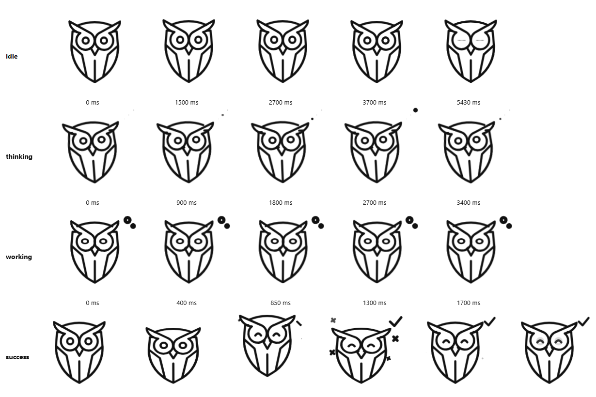

# Animated owl mascot

A framework-free animation rig for the owl in [`../behav.svg`](../behav.svg), with four states:
`idle`, `thinking`, `working` and `success`.



Why this approach and what else was evaluated: [docs/EVALUATION.md](docs/EVALUATION.md).

## Run it

Requirements: Node 20+ (tested on 24). No `npm install` needed, there are no dependencies.

```bash
cd pet/animated
npm start        # serves http://127.0.0.1:5173/demo/ (PORT=xxxx to change)
npm test         # contract tests + real-browser self test
npm run sheet    # regenerates docs/contact-sheet.png
npm run build    # regenerates assets/mascot.svg from ../behav.svg
```

The browser tests and the contact sheet need a Chromium-family browser (Chrome, Edge, Chromium).
It is auto-detected; set `BROWSER=<path>` to override. Without one, the browser test is skipped.

## Layout

| Path | Role | Depends on |
| --- | --- | --- |
| `../behav.svg` | Original artwork. Never modified. | - |
| `scripts/build-rig.mjs` | Derives the rig from the original's hidden `Capa_2` layer. | Node |
| `assets/mascot.svg` | Generated rig: one `data-part="..."` element per body part. | - |
| `src/mascot.spec.json` | **All animation data**: parts, rest poses, states, keyframes. | - |
| `src/mascot-engine.js` | Plays the spec on any SVG that has the parts. | Web Animations API |
| `demo/` | Demo page, contact sheet and the browser self test. | engine |

The engine knows nothing about the host app: it takes an SVG element and a spec object.

```js
import { createMascot } from './src/mascot-engine.js';

const mascot = createMascot(svgElement, spec);   // starts in spec.initialState
mascot.setState('thinking');                     // blends from the current pose
mascot.on((_, { from, to }) => { /* ... */ });   // returns an unsubscribe function
mascot.destroy();
```

Options: `speed` (playback multiplier), `blendMs` (cross-state blend, default 220),
`reducedMotion` (defaults to `prefers-reduced-motion`; freezes each state on a static pose).
`pause()`, `play()` and `seek(ms)` exist for deterministic tests and screenshots.

`success` is a one-shot: it plays once and returns to `idle` on its own (`"next"` in the spec).

## Spec format

Keyframe values are plain numbers: `x`/`y` in SVG units, `r` degrees, `s`/`sx`/`sy` scale,
`o` opacity, `d` stroke draw progress (0-1). Anything omitted falls back to the part's `rest` pose.
`origin` is the transform origin as a fraction of the part's box. Rules enforced by `validateSpec`
(also run by the tests): offsets start at 0 and end at 1, one track per part per state, no `delay`
(hold with keyframes), every part declared and present in the rig.

To tweak motion, edit the JSON and run `npm run sheet` to see the result.

## Porting to a PWA or Kotlin Multiplatform

- **PWA**: import the engine and spec as-is; wrap `createMascot` in your framework's lifecycle
  (create on mount, `destroy` on unmount). Map app events to `setState`.
- **Kotlin Multiplatform**: the contract is the JSON spec plus the part names, not the JS.
  Re-implement the small interpreter (about 150 lines: tracks of keyframes applied as
  translate/rotate/scale/alpha) with Compose `Animatable`/`graphicsLayer`, drawing the same parts from
  the SVG paths. This port is **not built yet**; keep new behaviour in the spec so both stay in sync.

## Known limits

- Tested only in Chromium/Edge. Firefox and Safari are not tested.
- The rig is built from `Capa_2`, the original's hidden stroke layer, because the visible layer is a
  single merged path that cannot be split without breaking its cut-outs. The two layers are close but
  not identical (the eye ring radius is set to 66 to match the visible layer): near-identical, not
  pixel-identical.
- One track per part per state: independent x/y timing on the same part needs a nested group.
- In headless Chromium with `--virtual-time-budget`, transform animations never start and
  `Animation.finished` never resolves (no frames are produced); the test runner therefore drives the
  browser in real time over DevTools (`scripts/browser.mjs`).
